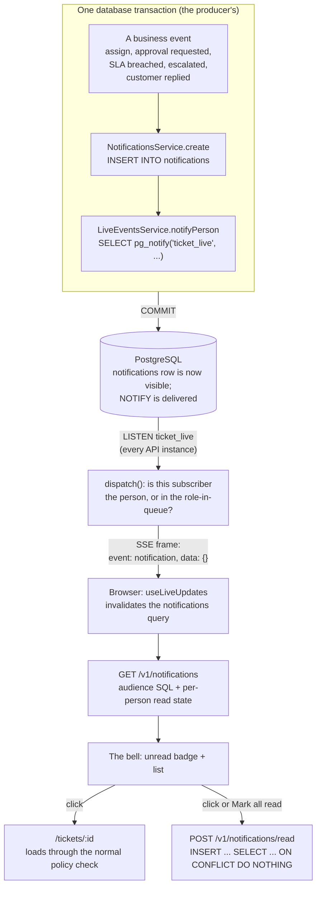
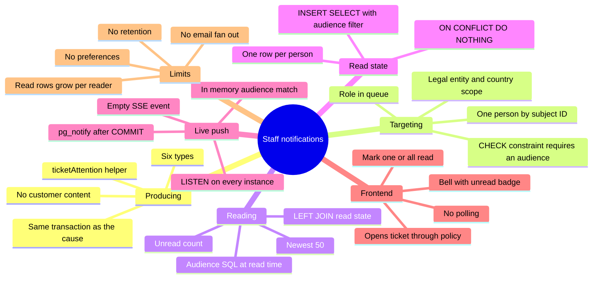

# Notifications: the staff inbox (the bell)

> **Staff notification**: a short, content-free message such as "A ticket was assigned to you" or "An approval is waiting for a decision", shown in the staff console's bell menu. It targets **one person**, or **everyone holding a role in a queue** (for example, all supervisors of `payments`), within one legal entity and country.
> In plain words: a sticky note on your desk saying "please look at case CASE-1A2B". It never contains the case details. Clicking it opens the case through the normal access check, so a note can never show you something you are not allowed to see.

Customer-facing messages (email, SMS, portal) are a different feature: see [Communications](../communications/README.md). This folder is only about telling **staff** that something needs their attention.

---

## The whole feature in one picture

Read it as two halves joined by the database:

1. **Writing (top).** A notification is a row inserted **inside the same transaction** as the event that caused it. If the event rolls back, the notification never existed and the push is never sent.
2. **Reading (bottom).** The browser is told only "something changed for you" (an empty SSE event) and then asks the server for its inbox through a normal, authorised API call. The audience is evaluated **at read time** against the user's current token.

---

## Mind map

---

## Where it lives

| File | Role |
|---|---|
| [notifications/notifications.service.ts](../../apps/api/src/notifications/notifications.service.ts) | `create`, `ticketAttention`, `inbox`, `unreadCount`, `markRead`, `audienceSql` |
| [notifications/notifications.controller.ts](../../apps/api/src/notifications/notifications.controller.ts) | `GET /v1/notifications`, `POST /v1/notifications/read`, the `MarkReadDto` |
| [notifications/notifications.module.ts](../../apps/api/src/notifications/notifications.module.ts) | `@Global()` so any service can create notifications without importing the module |
| [live/live-events.service.ts](../../apps/api/src/live/live-events.service.ts) | `notifyPerson` (producer side) and `dispatch` (consumer side) |
| [live/live-events.controller.ts](../../apps/api/src/live/live-events.controller.ts) | `GET /v1/events/stream`: the Server-Sent Events stream |
| [migration 1710000022000](../../apps/api/migrations/1710000022000_notifications_and_email.cjs#L14-L36) | `notifications`, `notification_reads`, the audience CHECK, two indexes |
| [web/src/layout/notification-menu.tsx](../../apps/web/src/layout/notification-menu.tsx) | The bell, unread badge, dropdown, mark read |
| [web/src/live/use-live-updates.ts](../../apps/web/src/live/use-live-updates.ts) | Turns the SSE `notification` event into a query invalidation |
| [web/src/api.ts#L191-L233](../../apps/web/src/api.ts#L191-L233) | The SSE client and the two notification API calls |
| [test/workflow.integration-spec.ts#L236-L245](../../apps/api/test/workflow.integration-spec.ts#L236-L245) | Integration test: right people, per-person read state |

---

## Reading order

| # | Page | You will learn |
|---|---|---|
| 0 | [Concepts](concepts.md) | Push vs pull, durable inbox vs ephemeral push, fan-out on write vs fan-out on read, LISTEN/NOTIFY, Server-Sent Events, invalidation, content minimisation |
| 1 | [How it works, end to end](how-it-works.md) | One assignment followed from the click to the red badge, step by step, with every line of code involved |
| 2 | [Data model and SQL](data-model-and-sql.md) | The two tables, the CHECK, the indexes, and the inbox, unread-count and mark-read queries explained clause by clause |
| 3 | [Producers](producers.md) | All eleven call sites that create notifications, which audience each uses, and why |
| 4 | [Live push](live-push.md) | `pg_notify` inside the transaction, the LISTEN connection, the in-memory audience match, the SSE stream, reconnects and resync |
| 5 | [Frontend: the bell](frontend.md) | The React component, TanStack Query invalidation, opening a ticket safely, accessibility |
| 6 | [Performance and limits](performance-and-limits.md) | Measured query plans, how read state grows, the missing index, retention, and what to build next |
| 7 | [Hands-on labs](hands-on-labs.md) | Eight experiments on a scratch database: audiences, read state, security, read-time membership, NOTIFY behaviour |
| 8 | [Interview Q&A](interview-qa.md) | 30-second and 2-minute answers, 30 questions, traps, honest limitations |

---

## 30-second answer

> Notifications are small rows created inside the same transaction as the event that caused them, so they exist if and only if that event committed. Each one targets either one person, or a role in a queue within a legal entity and country, and a CHECK constraint guarantees it has an audience. The inbox query matches the current user's token claims against that audience at read time, so leaving a queue stops its notifications immediately, and read state is one row per person, so one supervisor reading does not clear it for the others. Creation also fires a content-free `pg_notify` that every API instance turns into an empty SSE event for matching users, and the browser simply refetches its inbox. A notification carries only a title and a ticket ID, and opening it goes through the normal ticket policy, so it is never an access grant.

## 2-minute answer (structure)

1. **Why rows, not just pushes:** a durable inbox survives offline users; the push is only an accelerator.
2. **Targeting:** person or role-in-queue; one row for a whole audience (fan-out on read), matched at read time.
3. **Read state:** a separate per-person table, written with `INSERT ... SELECT` filtered by the same audience, so you cannot mark what you cannot see, and `ON CONFLICT DO NOTHING` makes it idempotent.
4. **Live:** `pg_notify` inside the transaction is delivered only on commit; every instance LISTENs and matches in memory; the browser gets an empty event and refetches.
5. **Security:** no content, policy on open, `ticket:read` required.
6. **Limits:** no retention yet, read rows grow with readers, a missing index on read state (measured 16 ms → 4 ms), no preferences or email fan-out.

---

## Related topics

[Live updates](../live-updates/README.md) · [Database: transactions](../database/transactions.md) · [Database: SQL patterns](../database/sql-patterns.md) · [Assignment](../assignment-and-routing/README.md) · [SLA](../sla/README.md) · [Compliance clocks](../compliance/README.md) · [Communications approvals](../communications/creating-and-approving.md) · [Intake customer replies](../intake/customer-replies.md)
