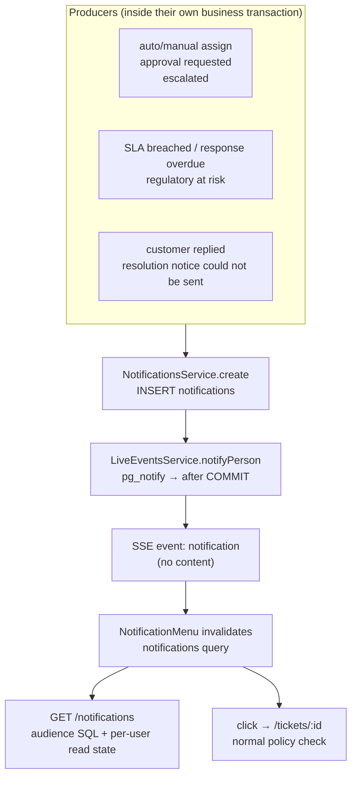

# Notifications: the staff inbox (bell)

> **Staff notification**: a short, content-free message such as "A ticket was assigned to you" or "An approval is waiting", shown in the console's bell menu. It targets **one person**, or **everyone holding a role in a queue** (e.g. supervisors of `payments`).
> In plain words: a sticky note on your desk saying "look at case CASE-1A2B". It never contains the case details; clicking it opens the case through the normal access check.

Customer-facing messages (email/SMS/portal) are a different thing: see [Communications](../communications/README.md).

## Picture

## Where it lives

| File | Role |
|---|---|
| [notifications/notifications.service.ts](../../apps/api/src/notifications/notifications.service.ts) | `create`, `ticketAttention`, `inbox`, `unreadCount`, `markRead`, `audienceSql` |
| [notifications/notifications.controller.ts](../../apps/api/src/notifications/notifications.controller.ts) | `GET /v1/notifications`, `POST /v1/notifications/read` |
| [notifications/notifications.module.ts](../../apps/api/src/notifications/notifications.module.ts) | `@Global` so any service can notify |
| [live/live-events.service.ts#L51-L54](../../apps/api/src/live/live-events.service.ts#L51-L54) | `notifyPerson` push hint |
| [web/src/layout/notification-menu.tsx](../../apps/web/src/layout/notification-menu.tsx) | The bell, unread badge, dropdown, mark read |
| [migration 1710000022000](../../apps/api/migrations/1710000022000_notifications_and_email.cjs#L14-L36) | `notifications`, `notification_reads` |

## Read in this order

1. [How notifications work](how-it-works.md): targeting, audience SQL, per-user read state, live push, the UI.
2. [Interview Q&A](interview-qa.md)

## 30-second answer

> Notifications are small, scoped rows created inside the same transaction as the event that caused them. They target either one subject or a role-in-queue within a legal entity and country. The inbox query matches the current user against that audience, and read state is stored per person, so one supervisor reading doesn't clear it for others. Creation fires a content-free `pg_notify` that becomes an SSE "notification" event, and the client refetches its inbox. Clicking opens the ticket through the normal policy check, so a notification is never an access grant.

## Related

[Live updates](../live-updates/README.md) · [Assignment](../assignment-and-routing/README.md) · [SLA](../sla/README.md) · [Communications approvals](../communications/creating-and-approving.md#3-approval-maker-checker) · [Intake customer replies](../intake/customer-replies.md)
