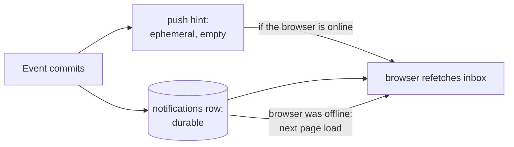

# Notification concepts

[Back to Notifications index](README.md) · Next: [How it works, end to end](how-it-works.md)

Every idea the notification feature is built from: the **technical term**, a **plain meaning**, an **analogy**, and **where it appears in our code**. The terms build on each other in order.

---

## 1. Pull, push, and why we do both

**Pull (polling).** The client asks the server "anything new?" on a timer. Plain: checking your letterbox every five minutes. Simple and robust, but wasteful (most checks find nothing) and slow (news waits for the next check). The bell does **not** poll ([notification-menu.tsx#L23-L24](../../apps/web/src/layout/notification-menu.tsx#L23-L24)).

**Push.** The server tells the client the moment something happens. Plain: the postman rings the doorbell. Fast and efficient, but a push is lost if nobody is home: a browser that is closed, asleep or reconnecting misses it.

**Durable inbox + push hint (what we do).** The notification is stored as a row (the letter goes in the letterbox), *and* a push tells online users to look now (the doorbell rings). If the push is missed, the row is still there the next time the inbox loads. The push carries **no content**; it is only a hint to refetch. This combination gives the reliability of pull and the speed of push.

---

## 2. Targeting and fan-out

**Recipient / audience.** Who a notification is for. Ours can be **a person** (`recipient_user`, an identity-provider subject ID) or **a role in a queue** (`recipient_queue` + `audience_role`, for example supervisors of `payments`), always scoped to a **legal entity and country**.

**Fan-out.** Turning one event into deliveries for many recipients. There are two places to do it:

- **Fan-out on write.** When the event happens, write one row **per recipient**. "Notify the 12 supervisors of payments" inserts 12 rows. Reading is trivial (`WHERE recipient = me`), but writing costs grow with audience size, and the recipient list is frozen at write time: someone who joins the queue a minute later never sees it, and someone who left still does.
- **Fan-out on read.** Write **one** row addressed to the audience *description* ("supervisors of payments in BANK-IN / IN"). Each reader's query works out whether they belong. Writing is constant, and membership is evaluated **now**, when the person reads.

We use **fan-out on read** for queue audiences ([notifications.service.ts#L50-L52](../../apps/api/src/notifications/notifications.service.ts#L50-L52)). Plain: instead of photocopying a memo for each supervisor's desk, pin one copy on the supervisors' noticeboard; whoever is a supervisor today reads it there.

**Read-time evaluation.** Because the audience is matched against the user's **current token claims** (queues and roles) on every read, removing someone from a queue in the identity provider removes that queue's notifications from their inbox at their next request. No cleanup job is needed.

**Per-person read state.** With fan-out on read there is one notification row but many readers, so "has it been read?" cannot be a column on the notification. It lives in a separate table, `notification_reads`, with one row per **(notification, person)**. One supervisor reading the noticeboard memo does not tick it off for the others.

---

## 3. Atomicity and the transactional producer

**Transactional notification.** The notification is inserted with the **same database client**, inside the **same transaction**, as the event that causes it ([notifications.service.ts#L20-L24](../../apps/api/src/notifications/notifications.service.ts#L20-L24) takes a `PoolClient`). Either both commit or neither does. Without this, a failed assignment could still tell someone "a ticket was assigned to you". See [Database: transactions](../database/transactions.md#4-the-same-client-rule).

**Idempotent.** Doing it twice has the same effect as once. Marking a notification read twice inserts nothing the second time (`ON CONFLICT DO NOTHING`), so double-clicks and retries are harmless.

---

## 4. The push channel: LISTEN/NOTIFY and SSE

**LISTEN / NOTIFY.** PostgreSQL's built-in publish/subscribe. A session runs `LISTEN ticket_live`; any transaction calls `pg_notify('ticket_live', payload)`; every listening session receives the payload, **but only when that transaction commits**. A rolled-back transaction's notifications are thrown away. Plain: a message placed in an envelope that is only posted if the transaction succeeds. Producer: [live-events.service.ts#L51-L54](../../apps/api/src/live/live-events.service.ts#L51-L54); listener: [L81-L97](../../apps/api/src/live/live-events.service.ts#L81-L97).

**Channel and payload.** The channel is a name (`ticket_live`, shared with ticket-change events). The payload is a text string up to about 8,000 bytes; we send small JSON. Within one transaction, **identical** payloads on the same channel are collapsed into one delivery ([lab 8](hands-on-labs.md#lab-8-notify-is-delivered-on-commit-and-duplicates-collapse)).

**Server-Sent Events (SSE).** A standard way for a server to stream events to a browser over one long-lived HTTP response. The server writes text frames like `event: notification\ndata: {}\n\n`; the browser reads them as they arrive. One-way (server to browser), plain HTTP, works through most proxies. Plain: a radio broadcast the browser keeps tuned to. Server: [live-events.controller.ts#L17-L35](../../apps/api/src/live/live-events.controller.ts#L17-L35); client: [api.ts#L191-L224](../../apps/web/src/api.ts#L191-L224).

**Why SSE and not WebSockets?** WebSockets are two-way. The bell only needs one-way "something changed" hints; requests the other way are ordinary REST calls. SSE is simpler, uses normal HTTP authentication headers, and reconnects easily.

**Fan-out across instances.** Every API instance holds its own LISTEN connection, so every instance hears every notification and checks it against **its own** connected browsers. No extra message broker (Redis pub/sub, Kafka) is needed for live updates.

**Resync.** If the LISTEN connection drops, notifications sent meanwhile are gone forever. On reconnect the server broadcasts a `resync` event and browsers refetch everything on screen ([live-events.service.ts#L93-L94](../../apps/api/src/live/live-events.service.ts#L93-L94)). The durable inbox means nothing is actually lost; only the instant refresh was missed.

---

## 5. On the browser side

**Query cache and invalidation.** TanStack Query keeps the inbox response in a cache under the key `['notifications']` ([query-keys.ts#L17](../../apps/web/src/lib/query-keys.ts#L17)). **Invalidating** that key marks the cached data stale and refetches it for any component showing it. The SSE `notification` event does exactly that ([use-live-updates.ts#L25](../../apps/web/src/live/use-live-updates.ts#L25)). Plain: the doorbell does not hand you the letter; it tells you to go and look in the letterbox.

**Optimistic UI (not used here).** Updating the screen before the server confirms. The bell instead waits for the mark-read call to succeed and then refetches, which keeps the unread count exactly what the server says.

---

## 6. Security ideas

**Content minimisation.** Store and send the least data needed. A notification has a fixed title ("The customer replied") and a ticket ID: no customer name, no account number, no message text. The push carries nothing at all. Even if a notification leaked, it reveals almost nothing.

**Not an access grant.** A notification is a pointer, not a permission. Opening it navigates to `/tickets/:id`, which loads through `GET /v1/tickets/:id` and the full ticket policy. If your access changed since the notification was written, you see "not available".

**Authorisation on the inbox.** `GET /v1/notifications` requires the `ticket:read` permission ([notifications.controller.ts#L14](../../apps/api/src/notifications/notifications.controller.ts#L14)). Administrators, who configure the system but have no case access, get no inbox and no bell ([app-layout.tsx#L37-L38](../../apps/web/src/layout/app-layout.tsx#L37-L38)).

**Scope check in SQL.** The audience filter is part of every query, including the mark-read insert, so a user cannot read or mark another person's notifications by guessing IDs.

Next: [How it works, end to end](how-it-works.md)
