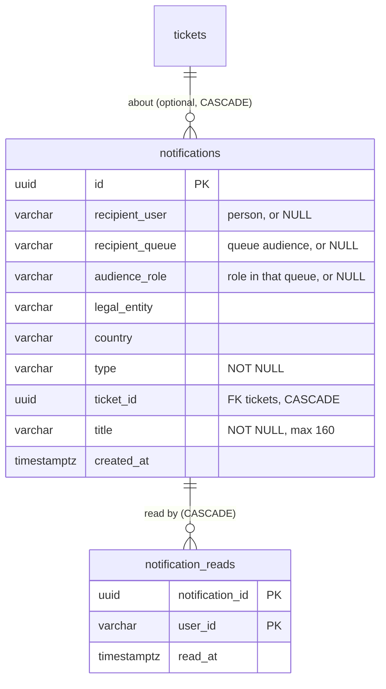

# Data model and SQL

[Back to Notifications index](README.md) · Previous: [How it works](how-it-works.md) · Next: [Producers](producers.md) · Code: [notifications.service.ts](../../apps/api/src/notifications/notifications.service.ts)

Two tables and three queries carry the whole feature. This page explains each column, constraint and index, then reads every query clause by clause. If a SQL idiom is new to you, the [Database SQL patterns cookbook](../database/sql-patterns.md) explains it in general.

---

## 1. The tables

From [migration 1710000022000#L14-L36](../../apps/api/migrations/1710000022000_notifications_and_email.cjs#L14-L36):



### `notifications`

| Column | Type | Meaning and design reason |
|---|---|---|
| `id` | `uuid` PK | Generated in code with `randomUUID()` ([L22](../../apps/api/src/notifications/notifications.service.ts#L22)) |
| `recipient_user` | `varchar(160)`, nullable | The person's identity-provider **subject** (the `sub` claim). Not a foreign key: staff live in the identity provider, not in our tables |
| `recipient_queue` | `varchar(80)`, nullable | For a queue audience, the queue key |
| `audience_role` | `varchar(40)`, nullable | For a queue audience, the role within the queue (always `supervisor` today) |
| `legal_entity`, `country` | `varchar`, nullable in the schema | Scope. Always filled by `create` (both target shapes carry them). For queue audiences they are part of the match |
| `type` | `varchar(40)` NOT NULL | One of six values defined by the TypeScript union `NotificationType` ([L8](../../apps/api/src/notifications/notifications.service.ts#L8)). There is no CHECK, so the type list is enforced by the compiler, not the database |
| `ticket_id` | `uuid`, FK `tickets` **ON DELETE CASCADE** | What the notification is about. Optional, so non-ticket notifications are possible in future |
| `title` | `varchar(160)` NOT NULL | A fixed sentence from code, never customer data |
| `created_at` | `timestamptz` default now | Sort order of the inbox. Note that `now()` is the producer's **transaction start** time |

### The audience CHECK

```sql
CONSTRAINT notifications_target_chk
  CHECK (recipient_user IS NOT NULL OR (recipient_queue IS NOT NULL AND audience_role IS NOT NULL))
```

A notification must have **an audience someone can match**: a person, or a complete queue+role pair. A queue without a role, or nothing at all, is refused ([lab 1](hands-on-labs.md#lab-1-the-two-shapes-and-the-check)). The service has the same rule in code ([L21](../../apps/api/src/notifications/notifications.service.ts#L21)); the CHECK makes it hold for every path that could ever write the table. The [constraints page](../database/constraints-and-integrity.md#3-check-constraints-business-rules-the-database-enforces) explains why both layers exist.

The constraint does not forbid having **both** a person and a queue. `create` prevents that by nulling queue and role when `user` is set, so each row has exactly one meaning.

### `notification_reads`

| Column | Meaning |
|---|---|
| `notification_id` | FK to `notifications`, **ON DELETE CASCADE**: a read marker without its notification is meaningless |
| `user_id` | The reader's subject |
| `read_at` | When they read it; `NOT NULL DEFAULT now()` |

The **composite primary key `(notification_id, user_id)`** is the rule "a person reads a notification at most once". It is what makes `ON CONFLICT DO NOTHING` work, and it provides the index the inbox's LEFT JOIN uses.

Why a separate table instead of a `read_at` column on `notifications`? Because one queue-audience row has **many** readers. Each needs their own read state ([concepts: fan-out](concepts.md#2-targeting-and-fan-out)).

### Indexes

```sql
CREATE INDEX ON notifications (recipient_user, created_at);
CREATE INDEX ON notifications (recipient_queue, audience_role, created_at);
-- plus the two primary keys
```

One index per half of the audience `OR`: "addressed to me", and "addressed to a queue+role I hold". PostgreSQL combines them with a `BitmapOr` ([performance](performance-and-limits.md#1-the-inbox-query-plan)).

---

## 2. The audience predicate

Every read query shares one fragment ([L50-L52](../../apps/api/src/notifications/notifications.service.ts#L50-L52)):

```sql
(n.recipient_user = $1                                     -- addressed to me (my subject)
 OR (n.recipient_queue = ANY($4::text[])                   -- or to a queue I hold
     AND n.audience_role = ANY($5::text[])                 -- with a role I have
     AND n.legal_entity = $2 AND n.country = $3))          -- in my legal entity and country
```

with parameters always in the same order: `[user.subject, user.legalEntity, user.country, user.queues, user.roles, ...]`. All five come from the **verified token** (`UserContext`), never from the request body.

Points worth understanding:

- **`= ANY($4::text[])`** passes the user's whole queue list as one array parameter ([SQL patterns 3](../database/sql-patterns.md#3-any1text-a-list-as-one-parameter)).
- **Scope applies to queue audiences only.** A person-addressed notification is matched by subject alone. A queue audience must also match entity and country, because queue names alone are not globally unique across a bank's entities.
- **Evaluated at read time.** If Priya's token stops listing `payments`, the second branch stops matching on her next request. Nothing is deleted; the rows simply no longer belong to her inbox ([lab 5](hands-on-labs.md#lab-5-membership-is-evaluated-at-read-time)).
- **The fragment is a fixed string** returned by a private method, never built from input, so interpolating it with `${this.audienceSql()}` is safe.

---

## 3. Reading the inbox

[inbox(), L32-L38](../../apps/api/src/notifications/notifications.service.ts#L32-L38):

```sql
SELECT n.id, n.type, n.ticket_id, n.title, n.created_at, r.read_at
FROM notifications n
LEFT JOIN notification_reads r ON r.notification_id = n.id AND r.user_id = $1
WHERE <audience>
ORDER BY n.created_at DESC
LIMIT $6
```

Clause by clause:

| Clause | What it does |
|---|---|
| `LEFT JOIN notification_reads r ON ... AND r.user_id = $1` | Attach **my** read marker if I have one. `r.user_id = $1` is in the `ON`, not the `WHERE`: in the `WHERE` it would discard every notification I have *not* read, which is the classic LEFT JOIN bug ([SQL patterns 9](../database/sql-patterns.md#9-left-join-with-the-filter-in-on-and-the-anti-join)) |
| `WHERE <audience>` | Only notifications meant for me |
| `ORDER BY n.created_at DESC` | Newest first |
| `LIMIT $6` | `Math.min(Math.max(limit, 1), 100)`; the controller uses the default **50**, so the bell shows at most the 50 newest |

In code, each row becomes `{ id, type, ticketId, title, createdAt, read: r.read_at !== null }`.

### The unread count

[unreadCount(), L40-L43](../../apps/api/src/notifications/notifications.service.ts#L40-L43):

```sql
SELECT count(*)::text AS n
FROM notifications n
LEFT JOIN notification_reads r ON r.notification_id = n.id AND r.user_id = $1
WHERE r.read_at IS NULL AND <audience>
```

`WHERE r.read_at IS NULL` after the LEFT JOIN is an **anti-join**: notifications with no read marker for me. It counts **all** unread, not only those in the newest 50, so the badge can say "99+" while the list shows 50. `count(*)` returns `bigint`, which the `pg` driver hands to JavaScript as a string, hence `::text` and `Number(...)`.

### Two queries, two snapshots

`inbox` runs the list and the count as **two separate autocommit statements** on the pool ([L33-L36](../../apps/api/src/notifications/notifications.service.ts#L33-L36)). Each sees its own snapshot ([MVCC](../database/mvcc-and-isolation.md#3-snapshots)), so a notification committed between them could appear in the count but not the list, or the reverse. The next refetch corrects it, which is acceptable for a badge. If it ever mattered, both could run in one `REPEATABLE READ` read-only transaction, or as one query with a window function.

---

## 4. Marking read: INSERT ... SELECT with the audience filter

[markRead(), L45-L47](../../apps/api/src/notifications/notifications.service.ts#L45-L47):

```sql
INSERT INTO notification_reads (notification_id, user_id)
SELECT n.id, $1
FROM notifications n
LEFT JOIN notification_reads r ON r.notification_id = n.id AND r.user_id = $1
WHERE r.read_at IS NULL                                -- not already read by me
  AND <audience>                                       -- only notifications I can see
  AND ($6::boolean OR n.id = ANY($7::uuid[]))          -- "all", or just these IDs
ON CONFLICT DO NOTHING
```

with `$6 = (ids === 'all')` and `$7 = ids` (or an empty array for "all").

This single statement carries four guarantees:

| Guarantee | Which part provides it |
|---|---|
| **You can only mark what you can see.** Sending another person's notification ID matches nothing and inserts nothing (`INSERT 0 0` in [lab 4](hands-on-labs.md#lab-4-you-cannot-mark-someone-elses-notification)) | the audience predicate inside the `SELECT` |
| **Read state is yours alone.** One supervisor reading does not clear it for the others | `user_id = $1` is the caller's subject from the token |
| **Idempotent.** Double-clicks, retries, and a "mark all" racing a single mark are harmless | `WHERE r.read_at IS NULL` skips already-read rows; `ON CONFLICT DO NOTHING` covers the race where two requests insert the same pair at once |
| **One round trip** for "mark all", whatever the count | `INSERT ... SELECT` runs in the database ([SQL patterns 8](../database/sql-patterns.md#8-insert--select-insert-the-result-of-a-query)) |

The `($6::boolean OR n.id = ANY($7::uuid[]))` trick switches between two behaviours with one SQL string ([SQL patterns 4](../database/sql-patterns.md#4-optional-filters-4type-is-null-or-)).

### The controller's input limits

```ts
class MarkReadDto { @IsOptional() @IsArray() @ArrayMaxSize(100) @IsUUID('all', { each: true }) ids?: string[]; }
...
await this.notifications.markRead(r.user!, dto.ids?.length ? dto.ids : 'all');
```

([notifications.controller.ts#L8](../../apps/api/src/notifications/notifications.controller.ts#L8), [L15](../../apps/api/src/notifications/notifications.controller.ts#L15).) At most 100 IDs, each a valid UUID (so the `::uuid[]` cast cannot fail with a 500). An empty or missing list means "mark all". Both endpoints require `ticket:read`.

---

## 5. Writing: the INSERT

[create(), L22](../../apps/api/src/notifications/notifications.service.ts#L22):

```sql
INSERT INTO notifications (id, recipient_user, recipient_queue, audience_role, legal_entity, country, type, ticket_id, title)
VALUES ($1, $2, $3, $4, $5, $6, $7, $8, $9)
```

```ts
[randomUUID(), target.user ?? null, target.user ? null : target.queue, target.user ? null : target.role,
 target.legalEntity, target.country, type, ticketId ?? null, title.slice(0, 160)]
```

It runs on the **producer's client**, so it is part of the producer's transaction. All nine values are parameters.

---

## 6. Deletion

There is no delete endpoint and no cleanup job. A notification disappears only through `ON DELETE CASCADE` when its ticket is deleted, and tickets are never deleted (retention **redacts** them). So both tables grow forever. [Performance and limits](performance-and-limits.md#4-growth-and-retention) measures what that means and proposes a retention job.

Next: [Producers](producers.md)
