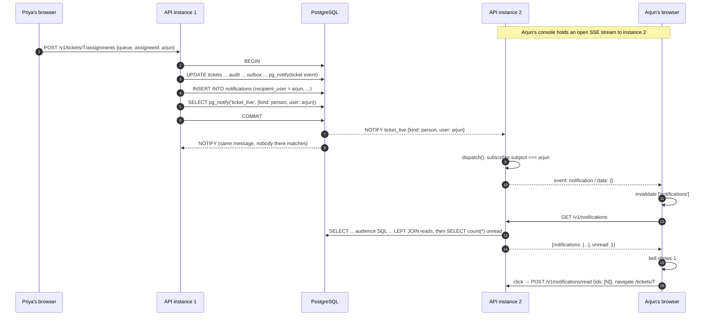

# How notifications work, end to end

[Back to Notifications index](README.md) · Previous: [Concepts](concepts.md) · Next: [Data model and SQL](data-model-and-sql.md)

The clearest way to understand the feature is to follow **one notification** from the moment it is caused to the moment someone clicks it. The story: **Priya, a supervisor, assigns ticket T to Arjun, an agent.** Arjun has the console open in another browser. Within a second a red "1" appears on his bell.

Every step links to the exact code. The deeper pages explain each part in detail.

---

## The journey at a glance



---

## Step 1. Priya assigns the ticket

In the ticket workspace, the assign modal calls `assignTicket` with the target queue, the assignee and the `updatedAt` Priya saw ([assign-modal.tsx#L40](../../apps/web/src/features/ticket/assign-modal.tsx#L40), [api.ts#L129](../../apps/web/src/api.ts#L129)). That is `POST /v1/tickets/T/assignments` with her bearer token. The guard verifies the token and builds her `UserContext`; the controller hands it to `TicketsService.assign`.

## Step 2. One transaction does the assignment and creates the notification

[tickets.service.ts#L131-L142](../../apps/api/src/tickets/tickets.service.ts#L131-L142):

```ts
return this.db.transaction(async (client) => {
  const ticket = await this.ticket(client, ticketId); this.policy.assertTicketAccess(user, ticket, 'ticket:assign'); this.assertFresh(ticket, dto.expectedUpdatedAt);
  if (!user.queues.includes(dto.queue)) throw new ForbiddenException('Target queue is outside your scope');
  const updated = await client.query('UPDATE tickets SET queue=$1, assigned_to=$2, status=$3, updated_at=now() WHERE id=$4 RETURNING *', [...]);
  await this.audit.write(client, { ... action: 'ticket.assigned' ... });
  await this.outbox.enqueue(client, { eventType: 'ticket.assigned', ... });
  await this.live.notify(client, 'ticket.assigned', updated.rows[0], ticket.queue);
  if (dto.assigneeId) await this.notifications.create(client, { user: dto.assigneeId, legalEntity: ticket.legal_entity, country: ticket.country }, 'ticket_assigned', 'A ticket was assigned to you', ticketId);
  return this.publicTicket(updated.rows[0]);
});
```

The last statement before `return` is the notification. Note the arguments: the **same `client`** as everything else, a **person** target (`user: dto.assigneeId`), a fixed **type** and a fixed **title**, and the ticket ID.

## Step 3. `create` inserts the row and queues the push

[notifications.service.ts#L20-L24](../../apps/api/src/notifications/notifications.service.ts#L20-L24):

```ts
async create(client: PoolClient, target: NotificationTarget, type: NotificationType, title: string, ticketId?: string): Promise<void> {
  if (!target.user && !(target.queue && target.role)) return;
  await client.query('INSERT INTO notifications (id,recipient_user,recipient_queue,audience_role,legal_entity,country,type,ticket_id,title) VALUES ($1,...,$9)',
    [randomUUID(), target.user ?? null, target.user ? null : target.queue, target.user ? null : target.role, target.legalEntity, target.country, type, ticketId ?? null, title.slice(0, 160)]);
  await this.live.notifyPerson(client, target);
}
```

Line by line:

1. **No audience, no notification.** If there is neither a person nor a complete queue+role, return quietly. (The database's CHECK constraint enforces the same rule as a backstop.)
2. **One row.** For a person target, the queue and role columns are forced to NULL so a row is never ambiguous. The title is trimmed to the column's 160 characters.
3. **The push hint.** `notifyPerson` runs `SELECT pg_notify('ticket_live', '{"kind":"person","user":"arjun",...}')` on the same client ([live-events.service.ts#L51-L54](../../apps/api/src/live/live-events.service.ts#L51-L54)).

At this moment **nothing is visible to anyone**. The row exists only inside Priya's open transaction, and PostgreSQL is holding the NOTIFY back.

## Step 4. COMMIT: the row appears and the NOTIFY is delivered

`PgService.transaction` commits ([pg.service.ts#L18](../../apps/api/src/database/pg.service.ts#L18)). Atomically: the ticket update, the history, the audit event, the outbox event and the notification row all become visible, and PostgreSQL delivers the queued NOTIFY messages to every session that is `LISTEN`ing on `ticket_live`.

If anything had thrown before COMMIT (Priya's view was stale, or she lacked the queue), the rollback would remove the notification row and **discard** the NOTIFY. Arjun would never hear about an assignment that did not happen.

## Step 5. Every API instance hears it and checks its own browsers

Each API process keeps one dedicated connection that ran `LISTEN ticket_live` at startup ([live-events.service.ts#L81-L97](../../apps/api/src/live/live-events.service.ts#L81-L97)). The message arrives at **all** instances. Each runs `dispatch` over the browsers connected **to it** ([L107-L116](../../apps/api/src/live/live-events.service.ts#L107-L116)):

```ts
if ('kind' in parsed && parsed.kind === 'person') {
  for (const subscriber of this.subscribers) {
    const u = subscriber.user;
    const mine = parsed.user ? u.subject === parsed.user
      : Boolean(parsed.queue && parsed.role && u.queues.includes(parsed.queue) && u.roles.includes(parsed.role) && u.legalEntity === parsed.legalEntity && u.country === parsed.country);
    if (mine) this.safeSend(subscriber, { event: 'notification', data: {} });
  }
  return;
}
```

Instance 1 (where Priya is connected) finds no match. Instance 2 finds Arjun's stream, because `subject === 'arjun'`.

## Step 6. Arjun's browser receives an empty event

The SSE controller writes the frame onto Arjun's open HTTP response ([live-events.controller.ts#L23](../../apps/api/src/live/live-events.controller.ts#L23)):

```text
id: 17
event: notification
data: {}
```

It carries **nothing**: not the ticket, not the title, not even the notification ID. The browser's stream reader splits frames on blank lines and calls `onNotification` ([api.ts#L195-L200](../../apps/web/src/api.ts#L195-L200)), which `useLiveUpdates` wires to `queryClient.invalidateQueries({ queryKey: ['notifications'] })` ([use-live-updates.ts#L25](../../apps/web/src/live/use-live-updates.ts#L25)).

## Step 7. The bell refetches the inbox

Invalidation makes the bell's `useQuery` refetch `GET /v1/notifications` ([notification-menu.tsx#L24](../../apps/web/src/layout/notification-menu.tsx#L24)). The controller checks `ticket:read` and calls `inbox(user)` ([notifications.controller.ts#L14](../../apps/api/src/notifications/notifications.controller.ts#L14)), which runs two queries ([notifications.service.ts#L32-L43](../../apps/api/src/notifications/notifications.service.ts#L32-L43)):

- the newest 50 notifications whose **audience matches Arjun**, each with a `read` flag from a LEFT JOIN on *his* read markers;
- the count of matching notifications with **no** read marker for him.

The audience is computed from his **token's** subject, queues, roles, legal entity and country, at this moment ([data model and SQL](data-model-and-sql.md#3-reading-the-inbox)).

The response is `{ notifications: [{ id, type: 'ticket_assigned', ticketId: 'T', title: 'A ticket was assigned to you', createdAt, read: false }, ...], unread: 1 }`, and the badge shows **1** ([notification-menu.tsx#L42-L44](../../apps/web/src/layout/notification-menu.tsx#L42-L44)).

## Step 8. Arjun clicks it

[notification-menu.tsx#L32-L36](../../apps/web/src/layout/notification-menu.tsx#L32-L36):

```ts
const open = (ticketId: string | null, id: string) => {
  close();                                 // close the dropdown
  markRead.mutate([id]);                   // POST /v1/notifications/read { ids: [id] }
  if (ticketId) navigate(`/tickets/${ticketId}`);
};
```

Two independent things happen.

**Mark read.** The server runs one `INSERT ... SELECT` that writes a read marker for Arjun, **only if** the notification matches his audience and is not already read, with `ON CONFLICT DO NOTHING` ([notifications.service.ts#L45-L47](../../apps/api/src/notifications/notifications.service.ts#L45-L47)). On success the bell invalidates its query again and the badge drops to 0.

**Open the ticket.** The ticket page loads `GET /v1/tickets/T`, which runs the full ticket policy (entity, country, queue, sensitivity) and writes a `ticket.viewed` audit event. The notification granted nothing: if Priya had assigned the ticket to a queue Arjun cannot access, he would see "not available".

---

## What changes for a queue audience

Now take an **approval request**: an agent sends a resolution notice that needs a supervisor's approval. The producer calls `ticketAttention(..., { assignee: false, supervisors: true })` ([tickets.service.ts#L301](../../apps/api/src/tickets/tickets.service.ts#L301)), which creates **one** row with `recipient_queue = 'payments'`, `audience_role = 'supervisor'` ([notifications.service.ts#L27-L30](../../apps/api/src/notifications/notifications.service.ts#L27-L30)).

| Step | Person target | Queue audience |
|---|---|---|
| Rows written | 1 | **1**, whatever the number of supervisors |
| NOTIFY payload | `{kind: person, user}` | `{kind: person, queue, role, legalEntity, country}` |
| Live match in `dispatch` | `subject === user` | the subscriber's queues include the queue **and** roles include the role **and** same entity and country |
| Inbox match in SQL | `recipient_user = $me` | `recipient_queue = ANY($myQueues) AND audience_role = ANY($myRoles) AND legal_entity = $me AND country = $me` |
| Read markers | 1 when read | **one per supervisor** who reads it |

The integration test checks exactly this: after an agent marks all read, the agent's unread count is 0 but the supervisor's is not ([workflow.integration-spec.ts#L242-L244](../../apps/api/test/workflow.integration-spec.ts#L242-L244)).

---

## What if Arjun was offline?

Nothing is lost. In step 5 no instance has a stream for Arjun, so nobody is pinged. The row is in the database. When Arjun opens the console the next morning, the bell's `useQuery` runs on mount, `GET /v1/notifications` returns it, and the badge shows 1. The push is an **accelerator**, never the source of truth.

The same holds if his stream was reconnecting: the browser calls `onResync` after reconnecting ([api.ts#L208](../../apps/web/src/api.ts#L208)), which invalidates **every** query, so the inbox refetches.

Next: [Data model and SQL](data-model-and-sql.md)
