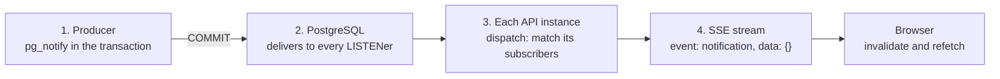

# Live push: from COMMIT to the browser

[Back to Notifications index](README.md) · Previous: [Producers](producers.md) · Next: [Frontend: the bell](frontend.md) · Code: [live-events.service.ts](../../apps/api/src/live/live-events.service.ts), [live-events.controller.ts](../../apps/api/src/live/live-events.controller.ts)

When a notification is created, people who are online should see the badge change within a second, without polling. This page follows the push through its four stages. The same machinery carries ticket-change events; the general design is in [Live updates](../live-updates/README.md), and this page focuses on the notification path.



---

## Stage 1. The producer: `notifyPerson`

[live-events.service.ts#L51-L54](../../apps/api/src/live/live-events.service.ts#L51-L54):

```ts
async notifyPerson(client: PoolClient, target: { user?: string; queue?: string; role?: string; legalEntity: string; country: string }): Promise<void> {
  const message: PersonMessage = { kind: 'person', user: target.user, queue: target.queue, role: target.role, legalEntity: target.legalEntity, country: target.country };
  await client.query('SELECT pg_notify($1, $2)', [CHANNEL, JSON.stringify(message)]);
}
```

`NotificationsService.create` calls this right after its INSERT, with the same client. The payload is the **audience description**, not the notification: who should refresh, nothing about what happened. `JSON.stringify` drops undefined fields, so the two shapes on the wire are exactly ([captured in lab 8](hands-on-labs.md#lab-8-notify-is-delivered-on-commit-and-duplicates-collapse)):

```text
{"kind":"person","user":"nlab-agent","legalEntity":"BANK-IN","country":"IN"}
{"kind":"person","queue":"nlab-payments","role":"supervisor","legalEntity":"BANK-IN","country":"IN"}
```

The `kind: 'person'` field is how the consumer tells these apart from ticket-change messages, which share the channel `ticket_live` ([L19](../../apps/api/src/live/live-events.service.ts#L19)).

The payload contains subject IDs and queue names. That is fine: it travels only between PostgreSQL and the API's own listener connections, and **never reaches a browser**.

---

## Stage 2. PostgreSQL: NOTIFY semantics you must know

`pg_notify(channel, payload)` inside a transaction behaves in four ways that the design relies on:

1. **Delivered only on COMMIT.** Until the transaction commits, the message is held. On ROLLBACK it is discarded. So a browser is never told about a notification that does not exist. [Lab 8](hands-on-labs.md#lab-8-notify-is-delivered-on-commit-and-duplicates-collapse) sends one message in a rolled-back transaction and one in a committed one; the listener receives only the second.
2. **Duplicates collapse within a transaction.** If the same transaction sends the identical payload on the same channel twice, listeners receive it once. Lab 8 sent three messages (two identical) and two arrived. For a "refresh your inbox" hint that is ideal: twenty notifications for one supervisor in one SLA batch cause one refetch per distinct audience, not twenty.
3. **Broadcast to all listeners.** Every session that ran `LISTEN ticket_live`, on any API instance, receives every message.
4. **Best effort.** A session that is not connected at the moment of delivery never receives the message. There is no replay. This is why the inbox is a table and the push is only a hint.

Payloads are limited to about 8,000 bytes; ours are under 150.

---

## Stage 3. Every API instance: listening and matching

### The listener connection

At startup each API instance opens **one dedicated connection** (not from the pool, [why](../database/connection-pool.md#5-the-second-kind-of-connection-listen)) and subscribes ([L81-L97](../../apps/api/src/live/live-events.service.ts#L81-L97)):

```ts
const client = new Client({ connectionString: process.env.DATABASE_URL });
const lost = () => { if (this.listener === client) this.listener = null; this.scheduleReconnect(); };
client.on('error', lost); client.on('end', lost);
client.on('notification', (message) => { if (message.channel === CHANNEL && message.payload) this.dispatch(message.payload); });
await client.connect();
await client.query(`LISTEN ${CHANNEL}`);
this.listener = client; this.attempt = 0;
if (this.hasConnectedBefore) this.broadcast({ event: 'resync', data: {} });
this.hasConnectedBefore = true;
```

| Detail | Why |
|---|---|
| `client.on('notification', ...)` | The `pg` driver emits each NOTIFY as an event on the connection |
| `on('error')` / `on('end')` → `scheduleReconnect()` | If PostgreSQL restarts or the network blips, reconnect with exponential backoff: 1 s, 2 s, 4 s, ... capped at 30 s ([L99-L105](../../apps/api/src/live/live-events.service.ts#L99-L105)) |
| `retryTimer.unref()` | The reconnect timer does not keep a shutting-down process alive |
| `if (this.stopped) { await client.end() }` after connect | If the app began shutting down while connecting, do not leave an orphaned connection ([L89-L90](../../apps/api/src/live/live-events.service.ts#L89-L90)) |
| **`resync` after a reconnect** | Messages sent while disconnected are gone. Telling every connected browser to refetch everything closes the gap ([L93-L94](../../apps/api/src/live/live-events.service.ts#L93-L94)) |

### Subscribers

Each open SSE stream registers a **subscriber**: the user's verified `UserContext` and a `send` function ([L56-L62](../../apps/api/src/live/live-events.service.ts#L56-L62)). They live in an in-memory `Set` per process. A user may hold at most **5** streams (several tabs); a sixth gets HTTP 429 ([L20](../../apps/api/src/live/live-events.service.ts#L20), [L57-L58](../../apps/api/src/live/live-events.service.ts#L57-L58)).

### `dispatch`: the in-memory audience match

[L107-L116](../../apps/api/src/live/live-events.service.ts#L107-L116):

```ts
let parsed: NotifyMessage | PersonMessage;
try { parsed = JSON.parse(raw); } catch { return; }                     // ignore anything malformed
if ('kind' in parsed && parsed.kind === 'person') {
  for (const subscriber of this.subscribers) {
    const u = subscriber.user;
    const mine = parsed.user
      ? u.subject === parsed.user                                        // person target
      : Boolean(parsed.queue && parsed.role && u.queues.includes(parsed.queue) && u.roles.includes(parsed.role)
                && u.legalEntity === parsed.legalEntity && u.country === parsed.country);   // role-in-queue target
    if (mine) this.safeSend(subscriber, { event: 'notification', data: {} });
  }
  return;
}
```

This is the **same audience rule as the SQL predicate** ([data model and SQL, section 2](data-model-and-sql.md#2-the-audience-predicate)), written a second time in TypeScript, because it runs against in-memory subscribers rather than rows. The two must agree. If they drifted, the effect would be mild in one direction (a user pinged for nothing refetches an inbox with nothing new) and noticeable in the other (a user not pinged sees the notification only at their next refetch). Neither can leak data, because the frame is empty and the inbox query is authoritative. A shared unit test of both rules would be a good addition.

`safeSend` removes a subscriber whose `send` throws, for example because the socket closed between checks ([L129](../../apps/api/src/live/live-events.service.ts#L129)).

Cost: each message is checked against every subscriber on every instance, which is cheap (a few comparisons per open tab) at the scale of a bank's staff.

---

## Stage 4. The SSE stream

[live-events.controller.ts#L17-L35](../../apps/api/src/live/live-events.controller.ts#L17-L35):

```ts
@Get('stream')
stream(@Req() request, @Res() reply): void {
  const user = request.user!;
  this.policy.assertPermission(user, 'ticket:read');
  let sequence = 0;
  const raw = reply.raw;
  const write = (frame: LiveFrame) => { raw.write(`id: ${++sequence}\nevent: ${frame.event}\ndata: ${JSON.stringify(frame.data)}\n\n`); };
  const unsubscribe = this.live.subscribe(user, write);           // throws 429 before the response is taken over
  reply.hijack();
  raw.writeHead(200, { ..., 'Content-Type': 'text/event-stream; charset=utf-8', 'Cache-Control': 'no-cache, no-transform', Connection: 'keep-alive', 'X-Accel-Buffering': 'no' });
  raw.write('retry: 5000\n\n: connected\n\n');
  const heartbeat = setInterval(() => raw.write(': ping\n\n'), 25_000);
  const expiry = setTimeout(() => { raw.write('event: expired\ndata: {}\n\n'); raw.end(); }, msUntilTokenExpiry);
  raw.on('close', () => { clearInterval(heartbeat); clearTimeout(expiry); unsubscribe(); });
}
```

| Line | Purpose |
|---|---|
| `assertPermission(user, 'ticket:read')` | Only case workers may stream. Administrators get no live feed and no bell |
| SSE frame format | `id:` a sequence number, `event:` the type, `data:` JSON, a blank line ends the frame. For notifications: `event: notification` / `data: {}` |
| `reply.hijack()` + `raw.writeHead` | Take the raw Node response from Fastify so it can stay open indefinitely, copying the CORS headers Fastify had set |
| `Cache-Control: no-transform`, `X-Accel-Buffering: no` | Stop proxies (and NGINX) from buffering or compressing the stream, which would delay frames |
| `retry: 5000` | Tells standard SSE clients to wait 5 s before reconnecting |
| `: ping` every 25 s | A comment line. Keeps idle proxies and load balancers from closing a quiet connection |
| expiry timer | **A stream must not outlive the token that authorised it.** At token expiry the server sends `expired` and closes; the browser reconnects with its renewed token |
| `on('close')` | Clean up timers and remove the subscriber when the browser goes away |

---

## Stage 5. The browser's stream client

The browser cannot use the built-in `EventSource`, because `EventSource` cannot send an `Authorization` header and the API requires a bearer token. Instead [api.ts#L191-L224](../../apps/web/src/api.ts#L191-L224) uses `fetch` and reads the response body as a stream:

```ts
const response = await fetch(`${baseUrl}/events/stream`, { headers: { Authorization: `Bearer ${user.access_token}`, Accept: 'text/event-stream' }, signal });
if (response.status === 401) { void signOut(); return; }
handlers.onConnection(true); attempt = 0;
if (connectedBefore) handlers.onResync();             // reconnected: anything may be stale
connectedBefore = true;
const reader = response.body.pipeThrough(new TextDecoderStream()).getReader(); let buffer = '';
for (;;) {
  const { done, value } = await reader.read(); if (done) break;
  buffer += value; const frames = buffer.split('\n\n'); buffer = frames.pop() ?? '';
  frames.forEach(dispatch);                            // 'notification' → handlers.onNotification()
}
// stream ended or failed: backoff 1 s, 2 s, 4 s ... capped at 30 s, then loop
```

Three behaviours to notice:

- **Frames can be split across chunks.** The reader keeps an incomplete trailing frame in `buffer` until the rest arrives.
- **Two layers of resync.** The *server* broadcasts `resync` when its LISTEN connection reconnects; the *browser* calls `onResync` itself when *its* stream reconnects. Both cases mean "you may have missed hints", and both make the app refetch everything on screen.
- **401 signs out.** An expired or revoked session ends the loop instead of retrying forever.

`useLiveUpdates` connects the handlers to the query cache ([use-live-updates.ts#L23-L29](../../apps/web/src/live/use-live-updates.ts#L23-L29)): `onNotification` invalidates `['notifications']`; `onResync` invalidates everything. It re-subscribes when the `user` object changes, so a renewed token is used for the next connection. The "Live / Offline" badge in the header shows `onConnection` ([app-layout.tsx#L56-L60](../../apps/web/src/layout/app-layout.tsx#L56-L60)).

---

## What the push guarantees, and what it does not

| Property | Guaranteed? |
|---|---|
| Never pings about a rolled-back notification | **Yes**: NOTIFY is delivered only on commit |
| Never carries notification content to the browser | **Yes**: the frame is `{}` |
| Every online recipient is pinged | Almost always. Not if their instance's LISTEN connection was down at that moment, in which case the `resync` on reconnect covers it |
| Offline recipients see the notification | **Yes**, at their next inbox load, because it is a row |
| Exactly one ping per notification | No: duplicates collapse within a transaction, and a resync refetches regardless. Neither matters for a refetch hint |
| Ordering | Not needed: the browser refetches the whole inbox, sorted by the server |

The principle to state in an interview: **the push is an optimisation; the table is the truth.** Anything the push gets wrong costs at most a delay, never correctness or confidentiality.

Next: [Frontend: the bell](frontend.md)
