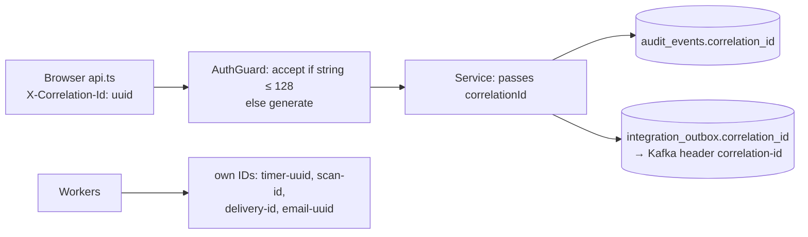

# Health, readiness and logs

[Back to Observability index](README.md)

---

## 1. Probes

[health.controller.ts#L9-L16](../../apps/api/src/health.controller.ts#L9-L16):

| Route | Checks | Meaning | Orchestrator action on failure |
|---|---|---|---|
| `GET /v1/health/live` | nothing | "The process is up and serving HTTP" | restart the pod |
| `GET /v1/health/ready` | `SELECT 1` | "I can do real work (DB reachable)" | stop sending traffic, don't restart |

No auth, excluded from rate limiting, and no version, environment or schema details in the response.

**Why only the DB in readiness?** Every business request needs PostgreSQL. Redis (fail-open), Kafka (outbox retries), S3, ClamAV and SMTP (workers retry) are optional or deferred, so making them readiness dependencies would turn a transient provider blip into a total outage. Their health shows up in **metrics** instead.

## 2. Three different "is it OK?" questions

| Question | Mechanism | Failure response |
|---|---|---|
| Is the configuration **safe**? | `assertProductionSafety()` before Nest starts ([main.ts#L14](../../apps/api/src/main.ts#L14)), plus `DatabaseGuardService` at module init | Process exits; never becomes ready |
| Is it **ready**? | `/health/ready` | Removed from the load balancer |
| Is it **alive**? | `/health/live` | Restarted |

See [token-hardening → production safety](../auth/token-hardening.md#5-production-safety-gate) for the safety checks.

## 3. Logs

- Fastify's built-in **pino** logger with `redact: ['req.headers.authorization', 'req.headers.cookie']` ([main.ts#L15](../../apps/api/src/main.ts#L15)): tokens never reach log storage.
- Nest `Logger` in services and workers, with prefixed messages, e.g. `AUDIT INTEGRITY FAILURE at sequence N`, `Released N stale in-flight outbox event(s)`, `Checksum mismatch for attachment X; not releasing`.
- Logs carry **opaque IDs**, not customer content (e.g. "Delivery attempt 2 failed for a communication: <reason>").

## 4. Correlation IDs

One click can be followed from the browser through the API logs, the audit trail and downstream Kafka consumers. Workers create recognisable prefixes, so an investigator can tell timer actions from user actions.

## 5. Request context for audit

`AsyncLocalStorage` holds IP, user agent, token `jti` and `acr` per request ([request-context.ts](../../apps/api/src/audit/request-context.ts)), merged into every audit event as `ctx_*`. With `TRUST_PROXY=true`, Fastify takes the client IP from `X-Forwarded-For`; only enable that behind a trusted proxy, otherwise callers can spoof their IP ([main.ts#L15](../../apps/api/src/main.ts#L15)).
