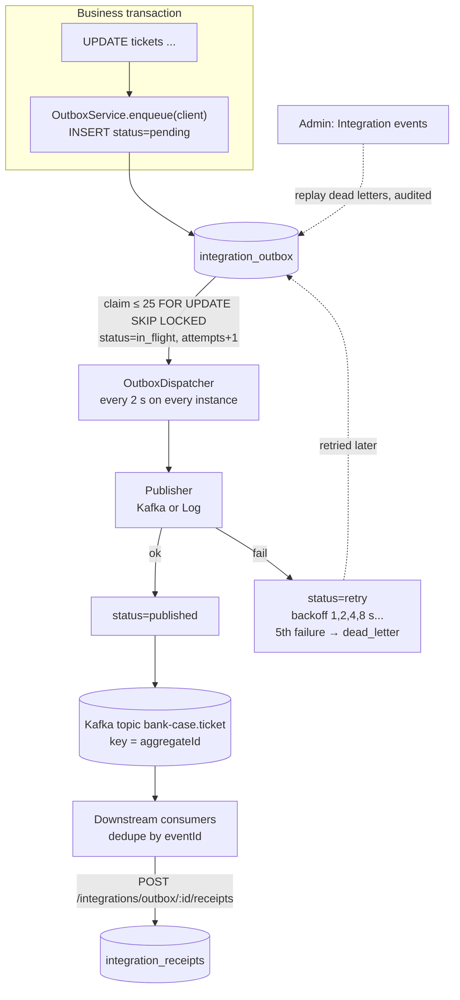

# Outbox: reliable integration events

> **Transactional outbox pattern**: when the database changes, write the "something happened" event into an **outbox table in the same transaction**. A separate dispatcher later publishes those rows to the message bus (Kafka).
> **Dual-write problem**: if you write to the database *and* call Kafka directly, one can succeed while the other fails, leaving them inconsistent. The outbox removes the second write from the transaction.
> In plain words: instead of phoning the other department during your work (and forgetting if they don't pick up), you drop a note in your out-tray as part of finishing the job; a courier empties the tray, retrying until delivered.

## Picture

## Where it lives

| File | Role |
|---|---|
| [outbox/outbox.service.ts](../../apps/api/src/outbox/outbox.service.ts) | `enqueue`, `processBatch`, `claim`, `markPublished`, `markFailed`, `releaseStale` |
| [outbox/outbox-dispatcher.ts](../../apps/api/src/outbox/outbox-dispatcher.ts) | Background loop |
| [outbox/outbox-publishers.ts](../../apps/api/src/outbox/outbox-publishers.ts) | Envelope, `LogOutboxPublisher`, `KafkaOutboxPublisher`, factory |
| [outbox/outbox.module.ts](../../apps/api/src/outbox/outbox.module.ts) | `@Global`; `OUTBOX_PUBLISHER` symbol provider |
| [integrations/integration.service.ts#L15-L32](../../apps/api/src/integrations/integration.service.ts#L15-L32) | Downstream receipts |
| [operations/outbox-admin.service.ts](../../apps/api/src/operations/outbox-admin.service.ts) | Summary, list, replay (audited) |
| [admin/sections/integration-section.tsx](../../apps/web/src/features/admin/sections/integration-section.tsx) | Admin UI |
| [event-catalogue.md](event-catalogue.md) | **Generated** list of every event type and payload |

## Read in this order

1. [How the outbox works](how-it-works.md): enqueue, claim, publish, retry, dead letter, crash windows.
2. [Publishers and Kafka](publishers-and-kafka.md): envelope, keys, headers, idempotent producer, ordering.
3. [Receipts and operations](receipts-and-operations.md): downstream receipts, dead-letter replay, admin screen, metrics.
4. [Event catalogue](event-catalogue.md): every event type (generated from source).
5. [Interview Q&A](interview-qa.md)

## Glossary

| Term | Plain meaning |
|---|---|
| **At-least-once delivery** | Every committed event is published one or more times, never zero; duplicates are possible |
| **Idempotent consumer** | A consumer that ignores an event it has already processed (by `eventId`) |
| **FOR UPDATE SKIP LOCKED** | "Lock rows for me, skip rows another dispatcher already locked", so many dispatchers drain the table in parallel without blocking |
| **Exponential backoff** | Waiting 1, 2, 4, 8... seconds between retries so a struggling bus isn't hammered |
| **Dead letter** | An event that failed too many times; parked for a human to fix the cause and replay |
| **Stale in-flight** | A row a dispatcher claimed but never finished (it crashed); released back to retry after 5 minutes |
| **Aggregate** | The thing an event is about (ticket, communication, attachment...); used as the Kafka partition key |
| **Envelope** | The standard wrapper every event has: `eventId`, `eventType`, `aggregateType`, `aggregateId`, `correlationId`, `occurredAt`, `payload` |
| **Data minimisation** | Payloads carry IDs and classifications only, never customer content |

## 30-second answer

> Every business change inserts its integration event into `integration_outbox` using the same transaction client, so the change and the event commit or roll back together. A dispatcher on every instance claims up to 25 due rows with `FOR UPDATE SKIP LOCKED`, marks them in-flight, publishes **outside** the lock, then marks them published or schedules an exponential retry; the fifth failure becomes a dead letter. A crash after publishing but before marking can duplicate an event, never lose one, so every envelope has a stable `eventId` for consumer de-duplication. Kafka messages are keyed by aggregate ID for per-ticket ordering, and dead letters are replayed through an audited admin action.

## Related

[Audit (SIEM stream + anchor events use the outbox)](../audit/README.md) · [Communications (receipts share the integration service)](../communications/delivery-and-receipts.md) · [Database (locking primitives)](../database/README.md) · [Observability (`outbox_events` gauge)](../observability/README.md) · [Learn NestJS → custom providers](../learn-nestjs/08-custom-providers-and-configuration/README.md)
