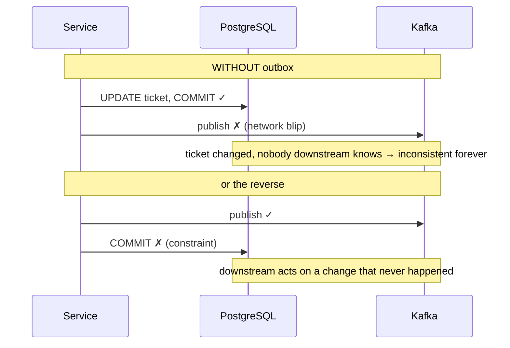
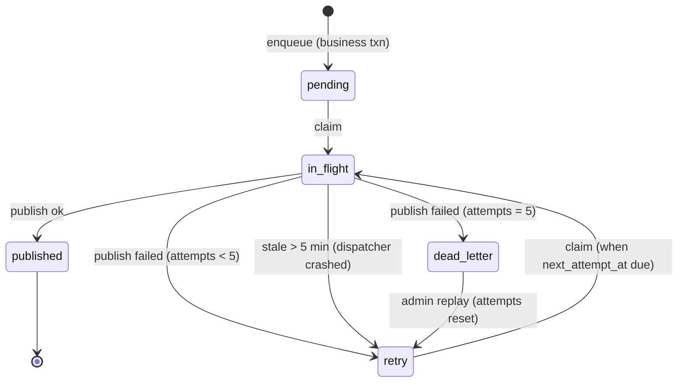

# How the outbox works

[Back to Outbox index](README.md) · Code: [outbox.service.ts](../../apps/api/src/outbox/outbox.service.ts)

---

## 1. Why: the dual-write problem



With the outbox, Kafka isn't part of the business transaction at all; the event is just another row.

## 2. Enqueue

[enqueue, L14-L16](../../apps/api/src/outbox/outbox.service.ts#L14-L16):

```ts
async enqueue(client: PoolClient, event: OutboxEvent): Promise<void> {
  await client.query(`INSERT INTO integration_outbox (id,event_type,aggregate_type,aggregate_id,correlation_id,payload) VALUES ($1,$2,$3,$4,$5,$6)`, [randomUUID(), ...]);
}
```

The signature **requires a `PoolClient`**, so you can't accidentally enqueue outside a transaction. Payload type: flat primitives only ([L6](../../apps/api/src/outbox/outbox.service.ts#L6)), which steers you away from embedding objects or customer text.

Table ([migration …05000](../../apps/api/migrations/1710000005000_integration_outbox.cjs), [+ claimed_at …14000](../../apps/api/migrations/1710000014000_outbox_claim_tracking.cjs)): `id, event_type, aggregate_type, aggregate_id, correlation_id, payload jsonb, status (pending|in_flight|retry|published|dead_letter), attempts, next_attempt_at, last_error, created_at, published_at, claimed_at`. Indexes: `(status, next_attempt_at)`, `(aggregate_type, aggregate_id)`, and a partial index on `claimed_at WHERE status='in_flight'`.

## 3. Claim → publish → mark

[processBatch, L18-L26](../../apps/api/src/outbox/outbox.service.ts#L18-L26):

```ts
const claimed = await this.db.transaction((client) => this.claim(client, batchSize));   // short txn #1
for (const event of claimed) {
  try { await publisher.publish(event);                                                 // NO transaction / locks held
        await this.db.transaction((c) => this.markPublished(c, event.id)); }            // short txn #2
  catch { const status = await this.db.transaction((c) => this.markFailed(c, event.id, event.attempts)); }
}
```

### The claim SQL

[claim, L34-L37](../../apps/api/src/outbox/outbox.service.ts#L34-L37):

```sql
WITH candidates AS (
  SELECT id FROM integration_outbox
  WHERE status IN ('pending','retry') AND next_attempt_at <= now()
  ORDER BY created_at
  FOR UPDATE SKIP LOCKED
  LIMIT $1)                                   -- clamped 1..100
UPDATE integration_outbox AS o
SET status='in_flight', claimed_at=now(), attempts=o.attempts+1
FROM candidates WHERE o.id = candidates.id
RETURNING o.*
```

| Piece | Plain meaning |
|---|---|
| `FOR UPDATE SKIP LOCKED` | Two dispatchers running the same query at the same time get **different** rows; nobody waits |
| `UPDATE ... RETURNING` in the same statement | Claim and fetch in one round trip |
| `status='in_flight'` + `claimed_at` | Others won't pick it even after this transaction commits |
| `attempts+1` at claim time | Counts the attempt even if the process dies mid-publish |
| `ORDER BY created_at` | Roughly oldest-first |

### Why publish outside the transaction?
Holding row locks while waiting on Kafka (maybe seconds) would block other work and exhaust connections. Claim fast, publish slow, mark fast.

### Marking

- `markPublished` ([L39](../../apps/api/src/outbox/outbox.service.ts#L39)): `status='published', published_at=now()` **`WHERE status='in_flight'`**, so a row released as stale and re-claimed elsewhere isn't double-marked inconsistently.
- `markFailed` ([L41-L45](../../apps/api/src/outbox/outbox.service.ts#L41-L45)): `attempts >= 5` → `dead_letter`; otherwise `retry` with `next_attempt_at = now() + 2^(attempts-1)` seconds (1, 2, 4, 8, capped at 3,600). `last_error` is a fixed category (`publisher_failure`), never a raw error message that might contain data.



## 4. Stale release

[releaseStale, L29-L32](../../apps/api/src/outbox/outbox.service.ts#L29-L32), run at most once a minute by the dispatcher ([dispatcher L43-L47](../../apps/api/src/outbox/outbox-dispatcher.ts#L43-L47)):

```sql
UPDATE integration_outbox SET status='retry', next_attempt_at=now(), claimed_at=NULL
WHERE status='in_flight' AND claimed_at < now() - (OUTBOX_STALE_SECONDS (300) * interval '1 second')
```

A dispatcher that crashed after claiming leaves rows `in_flight`; after 5 minutes another dispatcher releases them.

## 5. The dispatcher loop

[outbox-dispatcher.ts#L13-L56](../../apps/api/src/outbox/outbox-dispatcher.ts#L13-L56):

- Opt-in: `OUTBOX_DISPATCHER_ENABLED=true` ([L23](../../apps/api/src/outbox/outbox-dispatcher.ts#L23)), so tests and scripts don't race it.
- **Safe on every instance**, because of `SKIP LOCKED` (no leader election needed, unlike the scheduler).
- Batch of 25; if a full batch came back, **loop immediately** (`busy` → delay 0), otherwise wait `OUTBOX_POLL_MS` (2 s) ([L50-L54](../../apps/api/src/outbox/outbox-dispatcher.ts#L50-L54)). Plain words: drain a backlog fast, idle cheaply.
- `onModuleDestroy` stops the loop and closes the publisher (disconnects the Kafka producer).

## 6. Crash windows (memorise this table)

| Crash point | What happens | Lost? | Duplicate? |
|---|---|---|---|
| Before business COMMIT | No business row, no event | n/a | No |
| After COMMIT, before claim | Row stays `pending`, published later | No | No |
| After claim, before publish | Row `in_flight` → released after 5 min → retried | No | No |
| **After Kafka accepted, before `markPublished`** | Released after 5 min → **published again** | No | **Yes** |
| Kafka down | Retries with backoff → dead letter after 5 → admin replay | No | No |

The fourth line is why every consumer **must** de-duplicate by `eventId`. Exactly-once across PostgreSQL and Kafka isn't possible without a distributed transaction; we choose at-least-once with idempotent consumers.

## 7. Who enqueues?

Practically every mutation: tickets, attachments, communications, approvals, configuration, compliance, retention, escalation, SLA, audit anchors, the optional audit SIEM stream. See the generated [event catalogue](event-catalogue.md) (42 event types).

## 8. Tests

| Claim | Test |
|---|---|
| Create enqueues `ticket.created`; `processBatch` publishes it | [ticket.integration-spec.ts#L43](../../apps/api/test/ticket.integration-spec.ts#L43) |
| A failing publisher dead-letters after 5 attempts | [ticket.integration-spec.ts#L103](../../apps/api/test/ticket.integration-spec.ts#L103) |
| Kafka message keyed by aggregate with envelope and headers | [kafka.integration-spec.ts#L8](../../apps/api/test/kafka.integration-spec.ts#L8) (`KAFKA_TEST_BROKERS`) |
| Replay dead letters (admin), audited, not twice | [workflow.integration-spec.ts#L292](../../apps/api/test/workflow.integration-spec.ts#L292) |

Next: [Publishers and Kafka](publishers-and-kafka.md)
