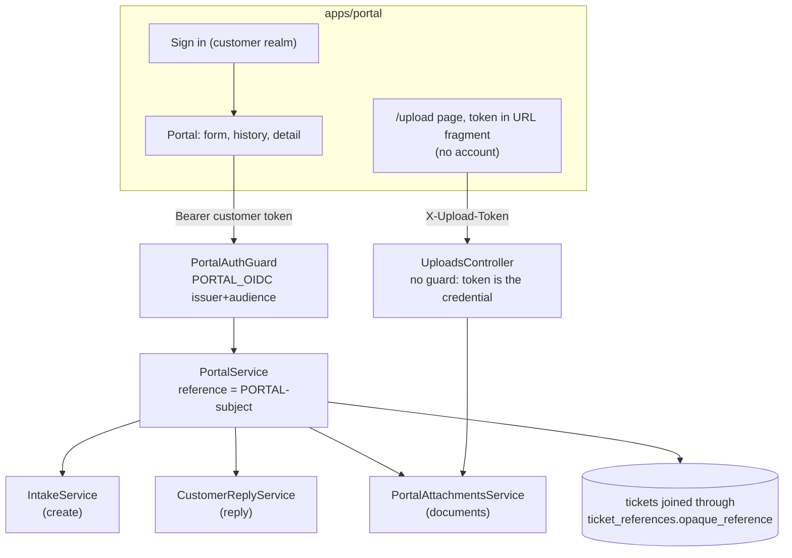

# Customer portal

> **Customer portal**: a separate React app (`apps/portal`) and API surface (`/v1/portal/*`) where bank customers raise requests, complaints or correction requests, follow their progress, reply, and send documents.
> **Separate identity boundary**: customers log in to a **different** identity realm (issuer and audience) than staff, and a **different guard** checks them. Ownership is derived from the customer's own token, never from IDs they send.
> In plain words: the bank's public counter, with its own door and its own ID check. Customers can only ever see their own files, and only the customer-friendly version of them.

## Picture

## Where it lives

| File | Role |
|---|---|
| [portal/portal-auth.guard.ts](../../apps/api/src/portal/portal-auth.guard.ts) | Customer token verification → `request.customer.subject` |
| [portal/portal.controller.ts](../../apps/api/src/portal/portal.controller.ts) | 6 routes, all `Cache-Control: no-store` |
| [portal/portal.service.ts](../../apps/api/src/portal/portal.service.ts) | Ownership, create via intake, list, detail projection, reply, rate limits |
| [portal/portal-attachments.service.ts](../../apps/api/src/portal/portal-attachments.service.ts) | Customer documents (shared by portal and secure links) |
| [portal/customer-attachment-status.ts](../../apps/api/src/portal/customer-attachment-status.ts) | "being checked / received / not accepted" |
| [email/message-template.ts](../../apps/api/src/email/message-template.ts) | `CASE-` reference and friendly status words |
| [apps/portal/src/](../../apps/portal/src/) | The customer React app |

## Read in this order

1. [Backend](backend.md): guard, ownership by reference, safe projections, create through intake, replies, rate limits.
2. [Frontend](frontend.md): the portal app, session, accessibility, documents, the upload page.
3. [Interview Q&A](interview-qa.md)

Documents (signed-in and link uploads) are explained in [Attachments → customer documents](../attachments/customer-documents.md) and [secure upload links](../attachments/secure-upload-links.md).

## Glossary

| Term | Plain meaning |
|---|---|
| **Customer reference** | `PORTAL-<token subject>` (hashed if very long), stored as the ticket's opaque reference; how we find "my" tickets |
| **Projection** | The customer-safe view: friendly status, customer-visible notes, sent portal messages, own document statuses. No internal notes, queue, assignee, SLA or internal status codes |
| **Non-enumerating 404** | "Not found" for both "doesn't exist" and "not yours", so nobody can probe IDs |
| **no-store** | HTTP header telling browsers and proxies not to cache sensitive responses |
| **Rate limit (per customer)** | Max requests, messages and uploads per hour, counted in the database |

## 30-second answer

> The portal is a separate OIDC app and a separate guard: customer tokens come from another realm, issuer and audience, so they can't call staff routes and staff tokens can't call portal routes. The guard only exposes the subject. The service derives `PORTAL-<subject>` and joins every query through that reference, so ownership is never taken from the request. Creation goes through the normal intake path, which gives idempotency, routing, SLA, audit and assignment. Responses are customer-safe projections with no-store caching, and replies and uploads are rate-limited and reuse the shared reply and upload state machines.

## Related

[Auth: customer guard](../auth/backend-guard.md#7-the-customer-guard-is-a-separate-boundary) · [Intake](../intake/README.md) · [Customer replies](../intake/customer-replies.md) · [Attachments](../attachments/README.md) · [Communications (portal messages)](../communications/README.md) · [Compliance (complaint clock shown to customer)](../compliance/README.md)
