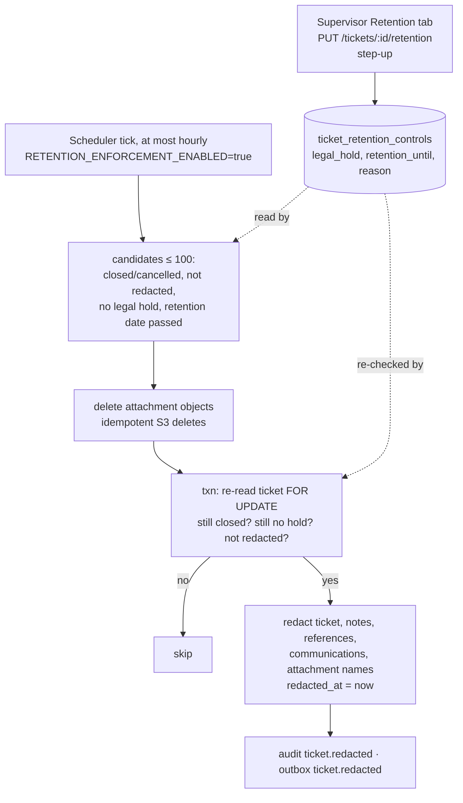

# Retention: legal hold and de-identification

> **Retention period**: how long a closed case's personal data is kept (default 7 years per category, or a supervisor-set date).
> **De-identification (redaction)**: when the period ends, personal data is removed (subject, description, notes, references, recipients, filenames, files), but a statistical skeleton (IDs, category, dates, status, outcome, root cause) is kept for reporting.
> **Legal hold**: a supervisor's "do not delete" flag for litigation or investigations; it always wins over scheduled deletion.
> In plain words: after seven years the bank shreds the letters in a closed folder but keeps the folder's label for statistics, unless a lawyer has put a "hold" sticker on it. (Privacy Act APP 11.2: destroy or de-identify personal information no longer needed.)

## Picture

## Where it lives

| File | Role |
|---|---|
| [retention/retention.service.ts](../../apps/api/src/retention/retention.service.ts) | Candidate selection + redaction |
| [workflow/workflow.module.ts#L12](../../apps/api/src/workflow/workflow.module.ts#L12) | Registers `RetentionService` (there is no separate RetentionModule) |
| [workflow/workflow-scheduler.ts#L45-L47](../../apps/api/src/workflow/workflow-scheduler.ts#L45-L47) | Opt-in, hourly call |
| [tickets/tickets.service.ts#L103-L118](../../apps/api/src/tickets/tickets.service.ts#L103-L118) | `updateRetentionControl` (legal hold / date) |
| [ticket/tabs/retention-tab.tsx](../../apps/web/src/features/ticket/tabs/retention-tab.tsx) | Supervisor UI |
| Tables | `ticket_retention_controls`; ticket columns `closed_at`, `redacted_at`; category `retention_years` |

## Read in this order

1. [How retention works](how-it-works.md): legal-hold API, eligibility, redaction, the cross-store race and its fix, the UI.
2. [Interview Q&A](interview-qa.md)

## 30-second answer

> A legal hold or a retention date is set by a supervisor with step-up, audited without storing the reason text. An opt-in hourly job picks up to 100 closed tickets whose effective retention date (an override, or closed date plus category years) has passed and that aren't on hold. It deletes their files idempotently, then in a transaction re-reads the ticket under lock, re-checks the hold and status, and overwrites every personal field, keeping the skeleton and the audit trail, which holds no free text by design. I'd also point out the current race: files are deleted before the locked hold re-check, so the fix is a durable "pending redaction" claim first.

## Related

[Attachments (object deletion)](../attachments/README.md) · [Audit (why audit stays)](../audit/event-model.md#7-minimisation-in-practice) · [Workflow scheduler](../workflow/scheduler.md) · [Compliance](../compliance/README.md)
