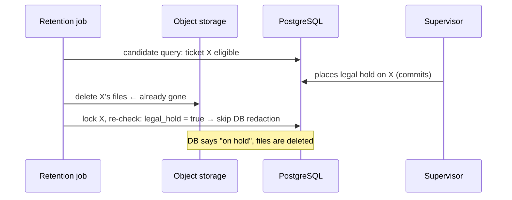

# How retention works

[Back to Retention index](README.md) · Code: [retention.service.ts](../../apps/api/src/retention/retention.service.ts)

---

## 1. Setting a legal hold or retention date

`PUT /v1/tickets/:id/retention` `{ legalHold, retentionUntil?, holdReason? }` → [updateRetentionControl, tickets.service.ts#L103-L118](../../apps/api/src/tickets/tickets.service.ts#L103-L118):

| Rule | Code |
|---|---|
| `ticket:hold` (supervisor) in scope | [L105](../../apps/api/src/tickets/tickets.service.ts#L105) |
| **Step-up** "change a legal hold or retention date" | same line |
| Enabling a hold needs a reason | [L106](../../apps/api/src/tickets/tickets.service.ts#L106) |
| A date must be in the future | [L107](../../apps/api/src/tickets/tickets.service.ts#L107) |
| Upsert into `ticket_retention_controls` | [L109-L112](../../apps/api/src/tickets/tickets.service.ts#L109-L112) |
| Audit: new + previous hold and date, `hasHoldReason`, **no reason text** | [L113](../../apps/api/src/tickets/tickets.service.ts#L113) |
| Outbox `ticket.retention_control_updated` (no reason) | [L114](../../apps/api/src/tickets/tickets.service.ts#L114) |

DTO: [UpdateRetentionControlDto, ticket.dto.ts#L56](../../apps/api/src/tickets/ticket.dto.ts#L56).

## 2. Eligibility

[run, L24-L33](../../apps/api/src/retention/retention.service.ts#L24-L33):

```sql
SELECT t.id FROM tickets t
JOIN ticket_categories c ON c.category_key = t.category
LEFT JOIN ticket_retention_controls rc ON rc.ticket_id = t.id
WHERE t.status IN ('closed','cancelled') AND t.redacted_at IS NULL AND t.closed_at IS NOT NULL
  AND COALESCE(rc.legal_hold, false) = false
  AND COALESCE(rc.retention_until, t.closed_at + (c.retention_years * interval '1 year')) <= now()
ORDER BY t.closed_at LIMIT 100
```

**Effective retention date** = the supervisor's `retention_until` if set, otherwise `closed_at + category.retention_years` (default 7). `closed_at` is set when the status becomes closed or cancelled, and cleared on reopen ([tickets.service.ts#L188](../../apps/api/src/tickets/tickets.service.ts#L188)).

## 3. Redacting one ticket

[redact, L35-L52](../../apps/api/src/retention/retention.service.ts#L35-L52):

```ts
// 1. Files first: object deletion is idempotent, so a failure leaves the ticket to be retried next run.
for (const file of SELECT object_key FROM attachments WHERE ticket_id) await storage.deleteObject(file.object_key);
// 2. Database, in a transaction, re-checking under lock:
const row = SELECT t.status, t.redacted_at, rc.legal_hold FROM tickets t LEFT JOIN ticket_retention_controls rc ... FOR UPDATE OF t;
if (!row || row.redacted_at || row.legal_hold || !['closed','cancelled'].includes(row.status)) return false;
UPDATE tickets              SET subject='[redacted]', description='[redacted]', custom_fields='{}', redacted_at=now();
UPDATE ticket_notes         SET body='[redacted]';
UPDATE ticket_references    SET opaque_reference='[redacted]', masked_value='••••';
UPDATE ticket_communications SET recipient_reference='[redacted]', recipient_masked='••••';
UPDATE attachments          SET original_filename='[redacted]', checksum_sha256=NULL;
audit ticket.redacted (system:retention, attachmentsDeleted count) · outbox ticket.redacted
```

| Kept | Removed |
|---|---|
| IDs, category, priority, queue, branch, entity, country, dates, status, outcome, root cause, SLA fields | subject, description, custom fields, note bodies, reference values, recipient references, attachment names and checksums, **file bytes** |
| The audit trail (no free text by design) | n/a |

After redaction:

- Ticket mutations refuse ([tickets.service.ts#L157](../../apps/api/src/tickets/tickets.service.ts#L157), [L171](../../apps/api/src/tickets/tickets.service.ts#L171), [L273](../../apps/api/src/tickets/tickets.service.ts#L273)).
- The portal hides redacted tickets.
- Delivery skips their messages.
- Subject access withholds them.
- Downstream consumers receiving `ticket.redacted` should erase their own copies.

Errors per ticket are logged and don't stop the batch ([L31](../../apps/api/src/retention/retention.service.ts#L31)).

## 4. The cross-store race (be honest about this)



PostgreSQL and S3 can't share a transaction. The current order (files, then locked re-check) means a hold placed in the gap protects the database fields but **not** the files.

**Fix: a durable state machine.**

```text
eligible --(txn: lock, re-check hold, set redaction_pending)--> redaction_pending
redaction_pending --(idempotent S3 deletes, retried)--> files_deleted
files_deleted --(txn: lock, final re-check, redact fields)--> redacted
legal hold: refused (or must coordinate) while redaction_pending
```

Plus metrics for stuck `redaction_pending` rows and a runbook entry.

## 5. Retention tab (UI)

[retention-tab.tsx#L12-L46](../../apps/web/src/features/ticket/tabs/retention-tab.tsx#L12-L46) (`supervise` only): current state line, a **Legal hold** switch, **Keep until** (`datetime-local`, converted from and to ISO with time-zone care, [L22](../../apps/web/src/features/ticket/tabs/retention-tab.tsx#L22)), and a reason (required when newly enabling a hold). The note "Needs a recent sign-in. The reason is kept out of integration events." The form resets when saved values change (after a save or a colleague's live change). The header shows a "Legal hold" badge.

## 6. Tests

| Claim | Test |
|---|---|
| Expired tickets de-identified; never ones under legal hold | [workflow.integration-spec.ts#L153](../../apps/api/test/workflow.integration-spec.ts#L153) |
| Agents can't set holds; supervisors can; event emitted | [ticket.integration-spec.ts#L43](../../apps/api/test/ticket.integration-spec.ts#L43) |
| **Missing:** a hold placed between candidate selection and redaction | Add once the state machine exists |
