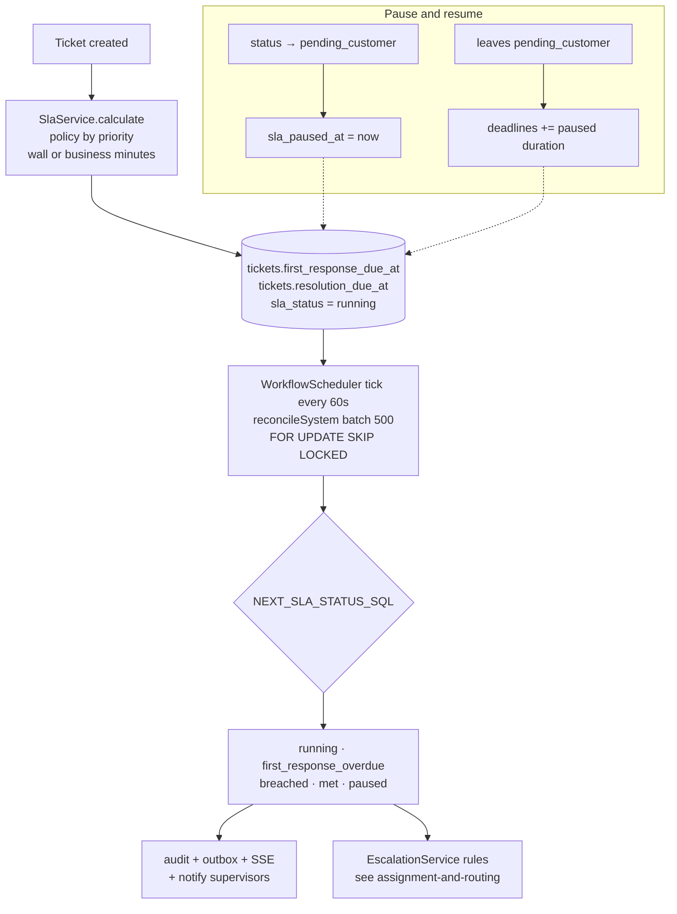

# SLA: service-level deadlines

> **SLA (service-level agreement)**: the bank's promise of how fast it will respond to and resolve a case.
> **SLA clock**: the two deadlines on every ticket, *first response due* and *resolution due*, plus a status saying whether they are being met.
> In plain words: when a ticket arrives, we stamp two "answer by" times on it. A background timer keeps checking them, raises flags when they are missed, and escalation rules can then move the ticket.

This folder covers how deadlines are calculated (wall clock or business hours), what counts as a "first response", pausing while waiting on the customer, the status formula, reconciliation (manual and by timer), and the administration screen.

Regulatory complaint clocks (acknowledge within N business days, final response within 30 days) are a **separate** clock in [Compliance](../compliance/regulatory-clocks.md). They share the same business calendar code.

## Picture

## Where it lives

| File | Role |
|---|---|
| [tickets/sla.service.ts](../../apps/api/src/tickets/sla.service.ts) | `calculate`, `pauseIfConfigured`, `resumeIfPaused`, `reconcile`, `reconcileSystem`, the status SQL |
| [compliance/business-calendar.ts](../../apps/api/src/compliance/business-calendar.ts) | `addBusinessMinutes` (SLA) and `addBusinessDays` (regulatory), time-zone and DST aware |
| [configuration/configuration.service.ts#L102-L117](../../apps/api/src/configuration/configuration.service.ts#L102-L117) | Upsert SLA policies |
| [compliance/compliance.service.ts#L174-L208](../../apps/api/src/compliance/compliance.service.ts#L174-L208) | Business hours and holidays configuration |
| [workflow/workflow-scheduler.ts#L42](../../apps/api/src/workflow/workflow-scheduler.ts#L42) | Calls `reconcileSystem` every tick |
| [dashboard/dashboard.controller.ts#L13](../../apps/api/src/dashboard/dashboard.controller.ts#L13) | `POST /dashboard/sla/reconcile` (manual) |
| [admin/sections/service-levels-section.tsx](../../apps/web/src/features/admin/sections/service-levels-section.tsx) | Policies + business hours UI |
| [ticket/case-sidebar.tsx#L61-L71](../../apps/web/src/features/ticket/case-sidebar.tsx#L61-L71) | "Service levels" card |
| Tables | `sla_policies`, `business_hours`, `business_holidays`; ticket columns `sla_*`, `first_responded_at`, `resolved_at` |

## Read in this order

1. [How the SLA clock works](how-it-works.md): calculation, first response, pause/resume, status formula, reconciliation, UI.
2. [Business calendar algorithm](business-calendar.md): `addBusinessMinutes` step by step, time zones, DST, holidays, tests.
3. [Interview Q&A](interview-qa.md)

## Glossary

| Term | Plain meaning |
|---|---|
| **SLA policy** | A row `(policy_key, priority) → first_response_minutes, resolution_minutes, calendar, pause_while_pending_customer, active`. Only `policy_key = 'default'` is used today |
| **Wall clock** (`calendar='wall'`) | Every minute counts, nights and weekends included |
| **Business calendar** (`calendar='business'`) | Only minutes inside working hours on working days, excluding public holidays, in the country's time zone |
| **First response** | The first customer-facing action: a customer note, a queued (or approved) communication, moving to `pending_customer`, or resolving |
| **Pause** | Stopping the clock while waiting on the customer; deadlines shift when it resumes |
| **Reconciliation** | Recomputing `sla_status` from the deadlines and current time, and recording each change |
| **Breached** | Resolution (or now, if unresolved) is after `resolution_due_at` |
| **SKIP LOCKED** | "Skip rows another worker is already processing", so several workers never block each other |

## 30-second answer

> At creation, `SlaService.calculate` picks the active policy for the ticket's priority and computes first-response and resolution deadlines, either in wall-clock minutes or working minutes using a time-zone-aware business calendar that skips weekends and holidays. The deadlines are stored on the ticket, so later policy edits don't rewrite history. Moving to "waiting on customer" can pause the clock, and resuming shifts both deadlines by the paused time. A scheduler re-derives `sla_status` with one SQL `CASE` in bounded, skip-locked batches, writing audit, outbox, live hints and supervisor notifications only for rows whose status actually changed.

## Related

[Tickets](../tickets/README.md) · [Workflow scheduler](../workflow/scheduler.md) · [Escalation](../assignment-and-routing/escalation.md) · [Compliance clocks](../compliance/regulatory-clocks.md) · [Dashboard](../dashboard/README.md)
