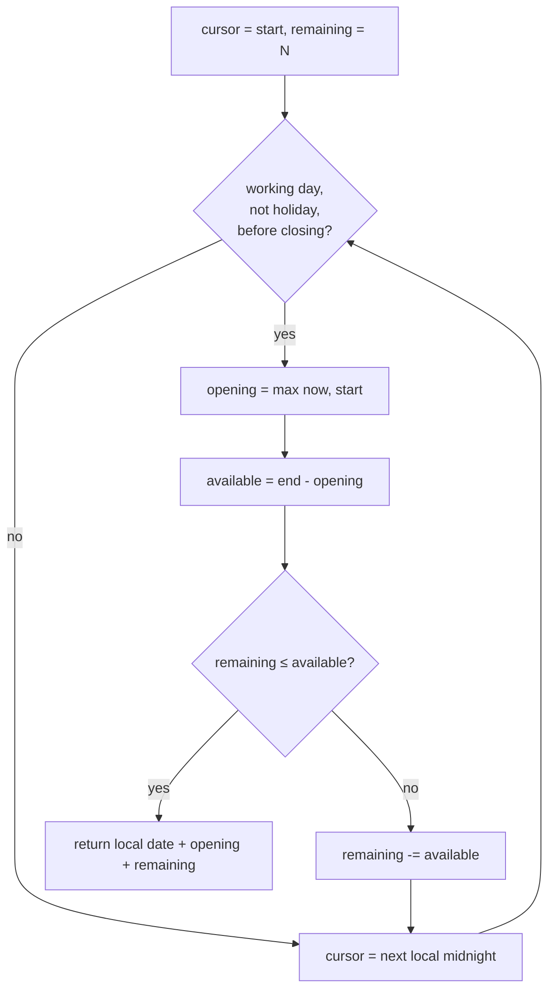

# Business calendar algorithm

Adding "4 working hours" to a timestamp is harder than it sounds. You have to deal with time zones, opening hours, weekends, public holidays and daylight saving. All of it lives in one dependency-free file: [compliance/business-calendar.ts](../../apps/api/src/compliance/business-calendar.ts).

[Back to SLA index](README.md)

---

## 1. Inputs

```ts
interface WorkingSchedule { timeZone: string; startMinute: number; endMinute: number; workingDays: readonly number[]; }
// e.g. { timeZone: 'Asia/Kolkata', startMinute: 570 /*09:30*/, endMinute: 1050 /*17:30*/, workingDays: [1,2,3,4,5] }
holidays: ReadonlySet<string>  // 'YYYY-MM-DD' in local time
```

- **IANA time zone** (`Australia/Sydney`, `Asia/Kolkata`): a named zone that knows its own DST rules, unlike a fixed offset such as `+10:00`.
- Minutes after midnight avoid string parsing; `0 = Sunday ... 6 = Saturday`.

---

## 2. Helper: wall-clock parts in a zone

[localParts, L28-L32](../../apps/api/src/compliance/business-calendar.ts#L28-L32):

```ts
const parts = Object.fromEntries(new Intl.DateTimeFormat('en-CA', { timeZone, hourCycle: 'h23', year:'numeric', month:'2-digit', day:'2-digit', hour:'2-digit', minute:'2-digit' })
  .formatToParts(instant).map((p) => [p.type, p.value]));
const date = `${parts.year}-${parts.month}-${parts.day}`;
return { date, minuteOfDay: Number(parts.hour) * 60 + Number(parts.minute), weekday: new Date(`${date}T12:00:00Z`).getUTCDay() };
```

- `Intl.DateTimeFormat` with `timeZone` is built into Node and uses the system's time-zone database, so no library is needed.
- `en-CA` formats dates as `YYYY-MM-DD`.
- The weekday is computed from the **calendar date at noon UTC**, so DST can never shift it to the wrong day (the comment at [L8](../../apps/api/src/compliance/business-calendar.ts#L8) says the same).

## 3. Helper: local wall time → instant

[localToInstant, L35-L45](../../apps/api/src/compliance/business-calendar.ts#L35-L45):

```ts
let guess = Date.parse(`${date}T00:00:00Z`) + minuteOfDay * 60_000;   // pretend the zone is UTC
for (let i = 0; i < 3; i++) {
  const shown = localParts(new Date(guess), timeZone);                 // what does the zone's clock show?
  const shownMs = Date.parse(`${shown.date}T00:00:00Z`) + shown.minuteOfDay * 60_000;
  const wantedMs = Date.parse(`${date}T00:00:00Z`) + minuteOfDay * 60_000;
  if (shownMs === wantedMs) break;
  guess += wantedMs - shownMs;                                         // correct by the difference (the offset)
}
```

**Plain:** "When is 09:30 in Sydney on 2026-10-06?" Guess as if Sydney were UTC, see what Sydney's clock would show at that instant, and correct by the difference. It converges in one or two steps, and a third handles DST transitions.

## 4. `addBusinessMinutes`

[L51-L64](../../apps/api/src/compliance/business-calendar.ts#L51-L64):

```ts
let remaining = Math.max(0, Math.round(minutes)); let cursor = from;
for (let guard = 0; guard < 4000; guard++) {
  const { date, minuteOfDay, weekday } = localParts(cursor, schedule.timeZone);
  if (schedule.workingDays.includes(weekday) && !holidays.has(date) && minuteOfDay < schedule.endMinute) {
    const opening = Math.max(minuteOfDay, schedule.startMinute);      // before opening → start at opening
    const available = schedule.endMinute - opening;
    if (remaining <= available) return localToInstant(date, opening + remaining, schedule.timeZone);
    remaining -= available;                                            // use up today, carry the rest
  }
  const next = new Date(Date.parse(`${date}T12:00:00Z`) + 24 * 3_600_000);
  cursor = localToInstant(next.toISOString().slice(0, 10), 0, schedule.timeZone);   // midnight of the next local day
}
throw new Error('Could not place the deadline within the working calendar');
```



### Worked example (Sydney 09:00-17:00, Mon-Fri)
Start **Friday 16:00**, add **120 min**:
1. Friday is a working day, before closing. Opening = 16:00, available = 60. Remaining 120 > 60, so remaining = 60.
2. Saturday, then Sunday: skipped.
3. Monday: opening = 09:00, available = 480. 60 ≤ 480, so the result is **Monday 10:00**.

If Monday is a holiday, the result is **Tuesday 10:00**. These two cases are exactly the test at [business-calendar.spec.ts#L22-L25](../../apps/api/test/business-calendar.spec.ts#L22-L25).

### Safety guard
The loop is capped at 4,000 iterations (more than 10 years of days). A misconfigured calendar, such as one with no working days, throws instead of hanging the request.

## 5. `addBusinessDays` (regulatory clocks)

[L16-L23](../../apps/api/src/compliance/business-calendar.ts#L16-L23): step 24 hours at a time and count only Mon-Fri non-holidays, **keeping the time of day**. It is used for "acknowledge within N business days" ([compliance.service.ts#L214](../../apps/api/src/compliance/compliance.service.ts#L214)). Zero days returns the same instant.

## 6. Tests

[business-calendar.spec.ts](../../apps/api/test/business-calendar.spec.ts):

| Case | Line |
|---|---|
| Fri + 1 business day → Mon | [L5](../../apps/api/test/business-calendar.spec.ts#L5) |
| Holiday on Monday → Tue | [L6](../../apps/api/test/business-calendar.spec.ts#L6) |
| Zero days = same instant | [L7](../../apps/api/test/business-calendar.spec.ts#L7) |
| Local date, not UTC (20:00Z = next day in Sydney) | [L8](../../apps/api/test/business-calendar.spec.ts#L8) |
| Tue 11:30 + 2 h → 13:30 | [L17](../../apps/api/test/business-calendar.spec.ts#L17) |
| Tue 16:00 + 3 h → Wed 11:00 (rollover) | [L18-L21](../../apps/api/test/business-calendar.spec.ts#L18-L21) |
| Fri 16:00 + 2 h → Mon 10:00; with Mon holiday → Tue 10:00 | [L22-L25](../../apps/api/test/business-calendar.spec.ts#L22-L25) |
| Start at 07:00 → counts from 09:00 | [L26](../../apps/api/test/business-calendar.spec.ts#L26) |
| Zero minutes and across April DST end | [L27-L30](../../apps/api/test/business-calendar.spec.ts#L27-L30) |

## 7. Interview answer

> I wrote a small dependency-free business calendar on top of `Intl.DateTimeFormat` with IANA time zones. `addBusinessMinutes` walks day by day in local time: on a working, non-holiday day it consumes the minutes between max(now, opening) and closing, otherwise it jumps to the next local midnight. Converting local wall time back to an instant iterates on the offset, which handles DST. Weekdays come from the calendar date at noon UTC, so DST can't flip them. The loop has a hard cap, so a bad calendar fails loudly, and unit tests cover rollovers, weekends, holidays, out-of-hours starts and DST.
