# How the SLA clock works

[Back to SLA index](README.md) · Code: [sla.service.ts](../../apps/api/src/tickets/sla.service.ts)

---

## 1. Calculating deadlines at creation

[sla.service.ts#L29-L42](../../apps/api/src/tickets/sla.service.ts#L29-L42):

```ts
async calculate(client, priority, now = new Date(), country?) {
  const policy = (await client.query(
    'SELECT first_response_minutes, resolution_minutes, calendar FROM sla_policies WHERE policy_key=$1 AND priority=$2 AND active=true',
    ['default', priority])).rows[0];
  if (!policy) throw new ConflictException(`No active SLA policy exists for priority ${priority}`);
  if (policy.calendar === 'business' && country) {
    const hours = (await client.query('SELECT timezone,start_minute,end_minute,working_days FROM business_hours WHERE country=$1', [country])).rows[0];
    if (hours) {
      const holidays = new Set((await client.query("SELECT to_char(holiday_date,'YYYY-MM-DD') AS d FROM business_holidays WHERE country=$1", [country])).rows.map((r) => r.d));
      const schedule = { timeZone: hours.timezone, startMinute: hours.start_minute, endMinute: hours.end_minute, workingDays: hours.working_days };
      return { policyKey: 'default', firstResponseDueAt: addBusinessMinutes(now, policy.first_response_minutes, schedule, holidays),
               resolutionDueAt: addBusinessMinutes(now, policy.resolution_minutes, schedule, holidays) };
    }
  }
  return { policyKey: 'default', firstResponseDueAt: new Date(now.getTime() + policy.first_response_minutes * 60_000),
           resolutionDueAt: new Date(now.getTime() + policy.resolution_minutes * 60_000) };
}
```

| Detail | Plain reason |
|---|---|
| Uses the caller's `client` | Part of the ticket creation transaction |
| No active policy → **409** | A ticket must never exist with undefined obligations |
| Deadlines **copied onto the ticket** | Changing the policy tomorrow doesn't rewrite the promise made today |
| Business calendar uses the ticket's **country** | Australian tickets use Sydney hours; Indian tickets use Kolkata hours |
| Holidays as a `Set` of `YYYY-MM-DD` strings | O(1) lookups while iterating days |

**Example** (seeded Indian hours 09:30-17:30, Mon-Fri, [migration …26000#L23](../../apps/api/migrations/1710000026000_sla_calendars_and_pause.cjs#L23)): a *normal* ticket with a business policy of 120 min first response, created Friday 16:30 IST, gets first response due **Monday 10:30 IST** (60 min Friday + 60 min Monday).

### Honest caveat
If a policy says `business` but the country has **no `business_hours` row**, the code silently falls back to wall-clock minutes. That keeps creation working, but changes the meaning of the deadline. A stricter production rule would reject activating a business policy without a calendar.

---

## 2. What counts as "first response"

`first_responded_at` is set **once** (`COALESCE(first_responded_at, now())`) by the first customer-facing action:

| Action | Code |
|---|---|
| Customer-visible note | [tickets.service.ts#L160](../../apps/api/src/tickets/tickets.service.ts#L160) |
| Communication created directly as `queued` | [L293](../../apps/api/src/tickets/tickets.service.ts#L293) |
| Approval that queues a pending communication | [L343](../../apps/api/src/tickets/tickets.service.ts#L343) |
| Status → `pending_customer` or `resolved` | [L184](../../apps/api/src/tickets/tickets.service.ts#L184) |
| Inbound email auto-acknowledgement | [inbound.worker.ts#L108](../../apps/api/src/email/inbound.worker.ts#L108) |

**Not** a first response: internal notes, or a communication still waiting for approval. **A customer's own reply never counts** ([customer-reply.service.ts#L13-L16](../../apps/api/src/intake/customer-reply.service.ts#L13-L16)), otherwise the customer could stop the bank's clock.

---

## 3. Pause and resume

**Pause**, called *before* the status update when entering `pending_customer` ([L45-L49](../../apps/api/src/tickets/sla.service.ts#L45-L49)):

```ts
if (toStatus !== 'pending_customer' || ticket.status === 'pending_customer') return;
const policy = (await client.query('SELECT pause_while_pending_customer AS pause FROM sla_policies WHERE policy_key=$1 AND priority=$2', [...])).rows[0];
if (policy?.pause) await client.query('UPDATE tickets SET sla_paused_at=COALESCE(sla_paused_at, now()) WHERE id=$1', [ticket.id]);
```

**Resume**, when leaving `pending_customer` ([L52-L54](../../apps/api/src/tickets/sla.service.ts#L52-L54)):

```sql
UPDATE tickets SET
  first_response_due_at = first_response_due_at + (now() - sla_paused_at),
  resolution_due_at     = resolution_due_at     + (now() - sla_paused_at),
  sla_paused_at = NULL
WHERE id=$1 AND sla_paused_at IS NOT NULL
```



```mermaid
gantt
  dateFormat HH:mm
  axisFormat %H:%M
  section Ticket
  Working (clock running)     :a1, 09:00, 2h
  Waiting on customer (paused):crit, a2, after a1, 3h
  Working again               :a3, after a2, 2h
  section Deadline
  Original resolution due 13:00 :milestone, 13:00, 0m
  Shifted resolution due 16:00  :milestone, 16:00, 0m
```

**Plain:** time spent waiting for the customer never counts against the bank.

The same resume SQL runs when a **customer replies** by portal or email and the ticket moves back to `in_progress` ([customer-reply.service.ts#L32](../../apps/api/src/intake/customer-reply.service.ts#L32)).

**Caveat:** the shift is the **wall-clock** duration of the pause, even for business-calendar policies. Pausing over a weekend therefore pushes a business deadline out by the full 48 hours, which is generous to the bank. A precise version would recompute the remaining business minutes from resume time.

---

## 4. The status formula

[sla.service.ts#L17](../../apps/api/src/tickets/sla.service.ts#L17), `NEXT_SLA_STATUS_SQL`:

```sql
CASE WHEN sla_paused_at IS NOT NULL                              THEN 'paused'
     WHEN COALESCE(resolved_at, now()) > resolution_due_at       THEN 'breached'
     WHEN COALESCE(first_responded_at, now()) > first_response_due_at THEN 'first_response_overdue'
     WHEN resolved_at IS NOT NULL                                THEN 'met'
     ELSE 'running' END
```

| Scenario | Result | Why |
|---|---|---|
| Waiting on customer with pause on | `paused` | First rule wins |
| Unresolved, now past resolution due | `breached` | `COALESCE(resolved_at, now())` = now |
| Resolved late | `breached` | Judged on actual resolution time; stays breached |
| Responded late but resolved in time | `first_response_overdue` | Breach has precedence; response lateness is remembered |
| Resolved in time, responded in time | `met` | |
| Otherwise | `running` | |

Writing it once, as a SQL string reused by both reconcilers, means **one definition** of the truth, evaluated inside the database with its clock.

---

## 5. Reconciliation

### By timer (all scopes)

[reconcileSystem, L83-L96](../../apps/api/src/tickets/sla.service.ts#L83-L96), called every scheduler tick ([workflow-scheduler.ts#L42](../../apps/api/src/workflow/workflow-scheduler.ts#L42)):

```sql
UPDATE tickets SET sla_status=<formula>, updated_at=now()
WHERE id IN (SELECT id FROM tickets
             WHERE status NOT IN ('closed','cancelled') AND sla_status IS DISTINCT FROM <formula>
             ORDER BY updated_at LIMIT $1 FOR UPDATE SKIP LOCKED)
RETURNING *
```

| Technique | Plain meaning |
|---|---|
| `IS DISTINCT FROM <formula>` | Only rows whose status *would change*, so a quiet system does no writes |
| `LIMIT 500` | One tick never holds a huge transaction; the rest wait for the next tick |
| `FOR UPDATE SKIP LOCKED` | Rows a person is editing right now are skipped, not waited on |
| `ORDER BY updated_at` | Oldest untouched first, fair progress |

For each changed row: audit `ticket.sla_<status>` by `system:sla-timer`, outbox `ticket.sla_status_changed`, live `ticket.sla_changed`, and for breached or response-overdue, a **notification to the assignee and queue supervisors** ([L88-L93](../../apps/api/src/tickets/sla.service.ts#L88-L93)).

### Manual (button / API)

[reconcile, L56-L77](../../apps/api/src/tickets/sla.service.ts#L56-L77) via `POST /v1/dashboard/sla/reconcile`:

- needs `sla:reconcile` (supervisor or administrator);
- **administrators**: whole legal entity + country; **supervisors**: only their queues;
- audit per changed row as the user (not the system actor).

Test: [ticket.integration-spec.ts#L43](../../apps/api/test/ticket.integration-spec.ts#L43). An agent gets 403; a supervisor updates the row to `first_response_overdue`; a second run updates **0**, which proves idempotency.

---

## 6. Administration

[service-levels-section.tsx](../../apps/web/src/features/admin/sections/service-levels-section.tsx):

| UI | API | Validation |
|---|---|---|
| Policy table: first response / resolution shown as "1 h 30 min" ([duration L19-L22](../../apps/web/src/features/admin/sections/service-levels-section.tsx#L19-L22)) | `PUT /configuration/sla/:policyKey/:priority` | 1-525,600 minutes; calendar `wall`/`business`; pause flag ([sla-policy.dto.ts](../../apps/api/src/configuration/sla-policy.dto.ts)) |
| Business hours: time zone, opens, closes, working-day chips | `PUT /configuration/business-hours` | start < end; valid IANA time zone (`Intl.DateTimeFormat` throws otherwise, [compliance.service.ts#L183](../../apps/api/src/compliance/compliance.service.ts#L183)) |
| Public holidays (under Compliance) | `PUT /configuration/holidays/:date` | `YYYY-MM-DD` |

Every save is audited with the previous row (`configuration.sla_policy_updated` with `previous`) and published to the outbox.

## 7. Display

- **Case sidebar** ([case-sidebar.tsx#L61-L71](../../apps/web/src/features/ticket/case-sidebar.tsx#L61-L71)): badge, "in 3 hours" with the exact time on hover, red once missed.
- **Queue** "Next due" column ([ticket-table.tsx#L19](../../apps/web/src/features/tickets/ticket-table.tsx#L19)) and "Overdue" view.
- **Labels** in one table ([labels.ts#L33-L40](../../apps/web/src/lib/labels.ts#L33-L40)).
- The browser **never recalculates** deadlines. Time-zone math belongs to the server.

## 8. Tests

| Claim | Test |
|---|---|
| Calendar math | [business-calendar.spec.ts](../../apps/api/test/business-calendar.spec.ts) ([details](business-calendar.md#6-tests)) |
| Business-hours deadline lands inside working hours; pause sets `paused`; resume shifts by ~2 h | [workflow.integration-spec.ts#L342](../../apps/api/test/workflow.integration-spec.ts#L342) |
| Manual reconcile permission + idempotency | [ticket.integration-spec.ts#L43](../../apps/api/test/ticket.integration-spec.ts#L43) |
| Resolve needs a root cause; first response recorded | [workflow.integration-spec.ts#L88](../../apps/api/test/workflow.integration-spec.ts#L88) |

Next: [Business calendar algorithm](business-calendar.md)
