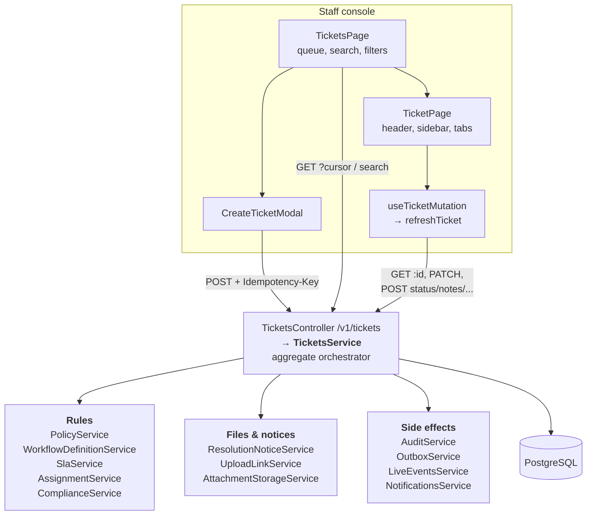

# Tickets: the case aggregate

> **Ticket (case)**: one customer issue the bank must handle, from the moment it is raised until it is closed and eventually de-identified.
> **Aggregate**: a cluster of rows treated as one unit for changes. Here that is the ticket plus its references, notes, history, attachments, relationships, communications and retention controls, all changed through one service inside one transaction.
> In plain words: the ticket is the folder; every note, letter and status stamp inside it is changed only by the folder's clerk (`TicketsService`), who also writes the audit log and the "something changed" notice in the same breath.

This folder covers creating, listing, searching, viewing and changing tickets, optimistic concurrency, the full status-change journey, the data model, and the staff screens (queue and case workspace). Sub-topics with their own folders are linked at the bottom: SLA, workflow, assignment, communications, attachments, compliance and retention.

## The whole thing in one picture

## Where it lives in the code

| Layer | File | What it does |
|---|---|---|
| Module | [tickets.module.ts](../../apps/api/src/tickets/tickets.module.ts#L13) | Wires controller + 6 providers; exports SLA and assignment services |
| HTTP routes | [tickets.controller.ts](../../apps/api/src/tickets/tickets.controller.ts) | 19 routes under `/v1/tickets`, all behind `AuthGuard` |
| DTOs | [ticket.dto.ts](../../apps/api/src/tickets/ticket.dto.ts) | Validated request shapes, enums (priorities, statuses, root causes) |
| Aggregate service | [tickets.service.ts](../../apps/api/src/tickets/tickets.service.ts) | Every ticket use case, transaction, policy, audit, outbox, live |
| Sub-services | [sla.service.ts](../../apps/api/src/tickets/sla.service.ts), [assignment.service.ts](../../apps/api/src/tickets/assignment.service.ts), [resolution-notice.service.ts](../../apps/api/src/tickets/resolution-notice.service.ts), [upload-link.service.ts](../../apps/api/src/tickets/upload-link.service.ts), [attachment-scan.worker.ts](../../apps/api/src/tickets/attachment-scan.worker.ts) | Documented in their own topic folders |
| Queue screen | [features/tickets/](../../apps/web/src/features/tickets/) | Page, table, create modal, query hooks, cache patching |
| Case screen | [features/ticket/](../../apps/web/src/features/ticket/) | Header, sidebar, description, modals, 7 tabs |

## Read in this order

| # | Document | What you will be able to explain |
|---|---|---|
| 1 | [Concepts and glossary](concepts.md) | Aggregate, idempotency key, keyset cursor, optimistic concurrency, masking, projection... |
| 2 | [Data model](data-model.md) | Every ticket table and column, and why it exists |
| 3 | [Create, read and search](create-read-search.md) | `POST /tickets` step by step, idempotency race, paging, search, detail projection |
| 4 | [Mutations and concurrency](mutations-and-concurrency.md) | Edit, notes, links, reveal, retention control; the optimistic-lock gap and its fix |
| 5 | [Status change, end to end](status-change-flow.md) | From the modal click to commit, audit, outbox, SSE and React Query |
| 6 | [Frontend: the queue](frontend-queue.md) | Infinite query, URL filters, debounced search, cache patching |
| 7 | [Frontend: the case workspace](frontend-workspace.md) | Tabs, capabilities, mutations, 403/404 handling |
| 8 | [Testing](testing.md) | What the integration tests prove |
| 9 | [Interview Q&A](interview-qa.md) | Answers, follow-ups, honest limitations |

## The 30-second interview answer

> Tickets are a transactional aggregate in NestJS. A guarded controller validates a DTO and passes the verified user and correlation ID to `TicketsService`. Each use case opens one PostgreSQL transaction, loads the current ticket, checks `PolicyService`, applies domain rules (workflow, redaction, communication block, optimistic version), writes the change, and in the same transaction appends audit, enqueues an outbox event and issues a commit-time live notification. Creation is idempotent through a persisted `(actor, key, request-hash)` record. Lists use keyset pagination with scope in SQL. The React side refetches one ticket after each change and patches it into every cached list.

## Related topics

| Topic | Why it matters to tickets |
|---|---|
| [Auth](../auth/README.md) | `assertTicketAccess`, step-up, maker-checker |
| [Audit](../audit/README.md) | Every view, list and change is audited |
| [SLA](../sla/README.md) | Deadlines calculated at creation, paused/resumed on status change |
| [Workflow](../workflow/README.md) | Which status transitions are legal |
| [Assignment and routing](../assignment-and-routing/README.md) | Auto-assign on create, manual assign, escalation |
| [Communications](../communications/README.md) | Customer messages, approvals, resolution notice |
| [Attachments](../attachments/README.md) | Upload intent, scan, download |
| [Compliance](../compliance/README.md) | Complaints, regulatory clocks, communication block |
| [Retention](../retention/README.md) | Legal hold and de-identification |
| [Live updates](../live-updates/README.md) | How other screens learn a ticket changed |
| [Outbox](../outbox/README.md) | `ticket.*` events for the bank's systems |
