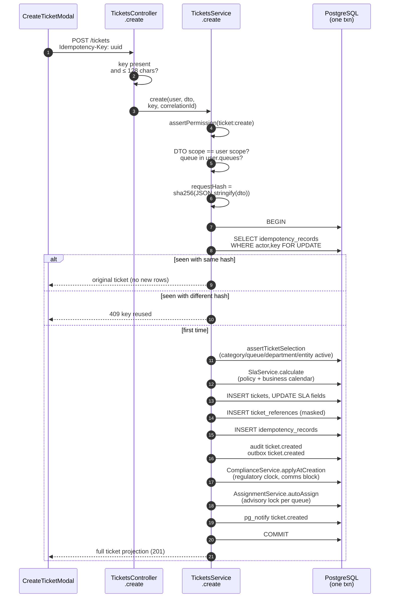
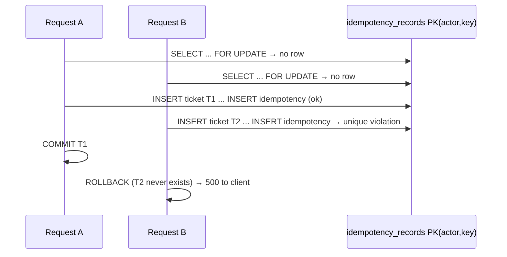

# Create, read and search tickets

[Back to Tickets index](README.md) · Terms: [concepts](concepts.md)

---

## 1. Routes in this page

| Route | Controller | Service | Permission |
|---|---|---|---|
| `POST /v1/tickets` (+ `Idempotency-Key`) | [L43-L53](../../apps/api/src/tickets/tickets.controller.ts#L43-L53) | `create` [L31-L60](../../apps/api/src/tickets/tickets.service.ts#L31-L60) | `ticket:create` |
| `GET /v1/tickets?cursor&limit` | [L54-L68](../../apps/api/src/tickets/tickets.controller.ts#L54-L68) | `list` [L69-L85](../../apps/api/src/tickets/tickets.service.ts#L69-L85) | `ticket:read` |
| `GET /v1/tickets/search?q&limit` | [L69-L74](../../apps/api/src/tickets/tickets.controller.ts#L69-L74) | `search` [L87-L97](../../apps/api/src/tickets/tickets.service.ts#L87-L97) | `ticket:read` |
| `GET /v1/tickets/:ticketId` | [L75-L80](../../apps/api/src/tickets/tickets.controller.ts#L75-L80) | `get` → `getInTransaction` [L351-L363](../../apps/api/src/tickets/tickets.service.ts#L351-L363) | `ticket:read` |

---

## 2. Creating a ticket

### 2.1 The DTO

[CreateTicketDto, ticket.dto.ts#L13-L26](../../apps/api/src/tickets/ticket.dto.ts#L13-L26):

```ts
category (2-80) · priority ∈ PRIORITIES · sensitivity ∈ SENSITIVITIES · queue (2-80)
branchCode (2-30) · department (2-80) · legalEntity (2-50) · country (exactly 2)
subject (3-200) · description (3-10,000) · customFields? object
references: ReferenceDto[] (≤ 10, each validated: type, sourceSystem, opaqueReference 8-255)
```

`@ValidateNested({ each: true }) @Type(() => ReferenceDto)` makes the pipe validate **each** reference as a real class, not a plain object.

### 2.2 The sequence



### 2.3 Line by line

| Step | Lines | Detail and reason |
|---|---|---|
| Permission | [L32](../../apps/api/src/tickets/tickets.service.ts#L32) | Branch, call-centre and case agents and supervisors |
| **Scope equality** | [L33-L35](../../apps/api/src/tickets/tickets.service.ts#L33-L35) | You can only create in **your own** branch/department/entity/country and one of **your** queues, so nobody can file a ticket into another region |
| Request hash | [L36](../../apps/api/src/tickets/tickets.service.ts#L36) | Fingerprint for idempotency |
| Idempotency lookup | [L38-L42](../../apps/api/src/tickets/tickets.service.ts#L38-L42) | Same hash → `getInTransaction(..., auditView=false)` returns the original without a second "viewed" event |
| Config check | [L44](../../apps/api/src/tickets/tickets.service.ts#L44) | `assertTicketSelection` re-checks that category, queue, department and entity are an **active, compatible** combination *now*, not when the UI loaded ([configuration.service.ts#L19-L22](../../apps/api/src/configuration/configuration.service.ts#L19-L22)) |
| SLA | [L45](../../apps/api/src/tickets/tickets.service.ts#L45), [L48](../../apps/api/src/tickets/tickets.service.ts#L48) | No active policy for the priority → 409; deadlines are persisted on the row |
| Insert | [L46-L47](../../apps/api/src/tickets/tickets.service.ts#L46-L47) | All values parameterised (`$1..$13`) |
| References | [L49-L51](../../apps/api/src/tickets/tickets.service.ts#L49-L51) | Stored with `masked_value` |
| Ledger | [L52](../../apps/api/src/tickets/tickets.service.ts#L52) | Idempotency record in the **same** transaction |
| Audit + outbox | [L53-L54](../../apps/api/src/tickets/tickets.service.ts#L53-L54) | Same client → atomic |
| Compliance | [L55](../../apps/api/src/tickets/tickets.service.ts#L55) | Category may start a complaint clock or block communications |
| Auto-assign | [L56](../../apps/api/src/tickets/tickets.service.ts#L56) | May set assignee + status `assigned` ([Assignment](../assignment-and-routing/auto-assignment.md)) |
| Live | [L57](../../apps/api/src/tickets/tickets.service.ts#L57) | `pg_notify`, delivered after commit |
| Response | [L58](../../apps/api/src/tickets/tickets.service.ts#L58) | Full projection, like `GET /:id` |

**Plain summary:** one click creates the ticket, its references, deadlines, compliance state, assignment, audit, integration event and live notice, or none of them.

### 2.4 The idempotency race (know this one)

The `FOR UPDATE` on a row that **doesn't exist yet** locks nothing. Two truly simultaneous first requests with the same key can both pass the lookup:



- **What is guaranteed:** no duplicate committed ticket. The primary key is the final guard, and B's whole transaction (T2, audit, outbox) rolls back.
- **What isn't:** B gets an error instead of T1.
- **Fix:** insert the idempotency row *first* (a reservation) or catch SQLSTATE `23505` on that constraint, then re-read and return the winner in a new transaction.

### 2.5 Frontend

[create-ticket-modal.tsx#L44-L65](../../apps/web/src/features/tickets/create-ticket-modal.tsx#L44-L65): scope fields come from `/me` (the API requires them to match anyway), the category picks a default queue, `createTicket` adds `Idempotency-Key: crypto.randomUUID()` ([api.ts#L125](../../apps/web/src/api.ts#L125)). On success the new ticket is written into the detail cache and prepended to lists, then the user is navigated to it. See [frontend-queue.md](frontend-queue.md).

---

## 3. Listing (paged)

[tickets.service.ts#L69-L85](../../apps/api/src/tickets/tickets.service.ts#L69-L85):

```ts
const pageSize = Math.min(Math.max(Math.trunc(limit) || 50, 1), 100);        // clamp 1..100
if (cursor) { const [createdAt, id] = Buffer.from(cursor, 'base64url').toString('utf8').split('|'); /* validate → else 400 */ }
SELECT * FROM tickets
 WHERE legal_entity=$1 AND country=$2 AND queue = ANY($3::text[])
   AND ($4::timestamptz IS NULL OR (created_at, id) < ($4::timestamptz, $5::uuid))
 ORDER BY created_at DESC, id DESC LIMIT $6                                   -- pageSize + 1
const page = rows.slice(0, pageSize); const more = rows.length > pageSize;    // the +1 trick
const visible = page.filter((t) => this.canRead(user, t));                    // branch/ownership/sensitivity
await this.auditListing(user, 'ticket.list_viewed', correlationId, visible.map((t) => t.id));
nextCursor = more ? base64url(`${last.created_at.toISOString()}|${last.id}`) : null
```

| Technique | Plain reason |
|---|---|
| Fetch `pageSize + 1` | If we got one extra row, there is a next page, without a `COUNT(*)` |
| Row-value comparison `(created_at, id) < (...)` | Correct tie-breaking for equal timestamps, and it uses the composite index |
| Cursor from the **raw** page (not `visible`) | Paging advances even when some rows were hidden by policy, so it never stalls |
| `X-Next-Cursor` response header ([controller L66](../../apps/api/src/tickets/tickets.controller.ts#L66)) | Body stays a plain array; the header is exposed by CORS ([main.ts#L22](../../apps/api/src/main.ts#L22)) |
| One audit event per page ([L63-L66](../../apps/api/src/tickets/tickets.service.ts#L63-L66)) | Records who looked and the first 50 IDs returned; `AUDIT_LIST_VIEWS=false` turns it off |

**Trade-off:** branch, ownership and sensitivity are filtered in memory, so a page may contain fewer than 50 visible rows. The scalable fix is to express the full policy in SQL.

---

## 4. Search

[tickets.service.ts#L87-L97](../../apps/api/src/tickets/tickets.service.ts#L87-L97):

- DTO: `q` 1-80 characters, `limit` 1-50, default 25 ([ticket.dto.ts#L55](../../apps/api/src/tickets/ticket.dto.ts#L55)).
- Escape `\`, `%`, `_`, then `ILIKE '%term%' ESCAPE '\'` over **subject, category, status and queue** only. No description, notes or references are searched, so the search can't leak content.
- Same SQL scope + in-memory `canRead`.
- Returns a **reduced projection** (id, subject, category, priority, status, sensitivity, queue, branch, createdAt). No SLA or assignee.
- Audited as `ticket.search_performed` with `hadSearchTerm: true`, and **without the term itself**.

---

## 5. Full detail (`GET /:id`)

[getInTransaction, L351-L363](../../apps/api/src/tickets/tickets.service.ts#L351-L363), in one transaction:

| Query | Returned as |
|---|---|
| ticket + `assertTicketAccess(ticket:read)` | base fields via `publicTicket` |
| `ticket_references` | `references[]` with **masked** values only |
| `ticket_notes` (oldest first) | `notes[]` |
| `attachments` | `attachments[]` (status, scan state, checksum) |
| `ticket_relationships` (both directions) | `relatedTickets[]` with `direction` |
| `ticket_communications` ⟕ `approval_requests` | `communications[]` (+ `approvalId` if pending) |
| `ticket_status_history` | `history[]` |
| `ticket_retention_controls` | `retention` |
| `WorkflowDefinitionService.nextStatuses(..., client)` | `allowedNextStatuses` filtered by the user's roles |
| `audit ticket.viewed` (only when `auditView=true`) | n/a |

- `nextStatuses` receives the **same client** ([workflow-definition.service.ts#L45-L47](../../apps/api/src/workflow/workflow-definition.service.ts#L45-L47)). The comment explains why: asking the pool for a second connection while holding one can deadlock a busy pool.
- Eight sequential queries are simple and consistent. At high volume you'd batch them or use JSON aggregation, carefully, to avoid row multiplication.
- **Note:** `:ticketId` routes don't use `ParseUUIDPipe` (only some do), so a malformed ID reaches PostgreSQL and errors there. It should be a clean 400.

---

## 6. Failure map

| Condition | Status |
|---|---|
| No `Idempotency-Key` or longer than 128 | 400 |
| DTO invalid / unknown field | 400 |
| Scope mismatch / no create permission | 403 |
| Same key, different body | 409 |
| Inactive/incompatible category+queue | 409 |
| No active SLA policy for the priority | 409 |
| Invalid cursor | 400 |
| Ticket not found | 404 |
| Ticket out of scope | 403 (UI shows the same as 404) |

Next: [Mutations and concurrency](mutations-and-concurrency.md)
