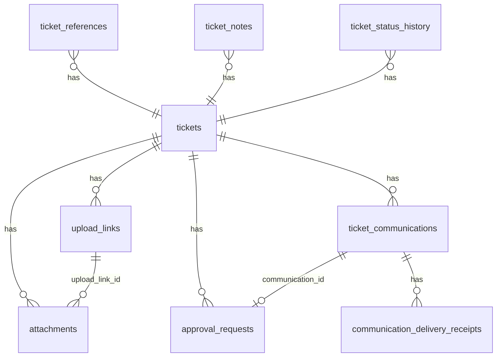
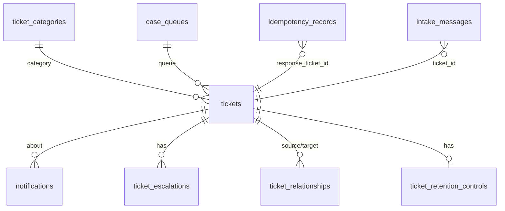

# Ticket data model

All tables are created by numbered migrations in [apps/api/migrations/](../../apps/api/migrations/). Migrations run as the schema owner; the API runs as a restricted account ([database-protection](../audit/database-protection.md#2-owner-vs-runtime-vs-reporting-roles)).

[Back to Tickets index](README.md)

---

## 1. Entity relationship overview

**What a ticket owns**

**What classifies a ticket or points at it**

---

## 2. `tickets` (the root)

| Group | Columns | Added in | Meaning |
|---|---|---|---|
| Identity | `id uuid` | initial | Primary key; first 8 hex chars form the customer reference `CASE-1A2B3C4D` |
| Classification | `category`, `priority`, `status` (default `submitted`), `sensitivity` | initial | What kind, how urgent, where in the lifecycle, how secret |
| Scope | `queue`, `branch_code`, `department`, `legal_entity`, `country` | initial | The attributes `PolicyService` checks |
| Content | `subject varchar(200)`, `description text`, `custom_fields jsonb` | initial | Personal data; removed by retention |
| People | `created_by`, `assigned_to` | initial | IdP subject IDs (or `intake:email` etc.) |
| Times | `created_at`, `updated_at` | initial | `updated_at` is the optimistic-concurrency version |
| SLA | `sla_policy_key`, `first_response_due_at`, `resolution_due_at`, `sla_status` | [1710000002000](../../apps/api/migrations/1710000002000_sla_policies.cjs) | Deadlines copied at creation ([SLA](../sla/README.md)) |
| SLA pause | `sla_paused_at` | [1710000026000](../../apps/api/migrations/1710000026000_sla_calendars_and_pause.cjs) | Set while waiting on the customer |
| Outcomes | `first_responded_at`, `resolved_at`, `root_cause` | [1710000017000](../../apps/api/migrations/1710000017000_sla_accuracy_root_cause.cjs) | First customer-facing action, resolution time, why it happened |
| Channel | `source_channel` | [1710000016000](../../apps/api/migrations/1710000016000_intake_channels.cjs) | `portal`, `email`, ... or null for staff-created |
| Complaints | `is_complaint`, `regulatory_profile`, `acknowledge_due_at`, `final_response_due_at`, `regulatory_status`, `idr_outcome`, `vulnerability_flag`, `systemic_issue`, `afca_status`, `afca_reference`, `communications_blocked` | [1710000018000](../../apps/api/migrations/1710000018000_regulatory_complaints.cjs#L32-L46) | See [Compliance](../compliance/README.md) |
| Privacy | `case_kind` (`complaint` / `privacy_request`) | [1710000027000](../../apps/api/migrations/1710000027000_privacy_correction.cjs) | Which outcome list applies |
| Lifecycle end | `closed_at`, `redacted_at` | [1710000020000](../../apps/api/migrations/1710000020000_retention_enforcement.cjs) | Retention clock start, de-identification time |

Indexes: `(queue, status)`, `(branch_code, created_at)`, `(sla_status, resolution_due_at)`, `regulatory_status WHERE is_complaint`, and the paging index `(legal_entity, country, queue, created_at DESC, id DESC)` ([1710000025000](../../apps/api/migrations/1710000025000_paging_and_reporting.cjs#L4)).

---

## 3. Child tables

| Table | Key columns | Written by | Notes |
|---|---|---|---|
| `ticket_references` | `reference_type`, `source_system`, `opaque_reference`, `masked_value`, `classification` | create, intake | Full value shown only on audited reveal |
| `ticket_notes` | `visibility` (`internal`/`customer`), `body`, `author_id` | `addNote`, customer replies | Customer notes appear in the portal |
| `ticket_status_history` | `from_status`, `to_status`, `reason`, `changed_by`, `changed_at` | transition, auto-assign, escalation, customer reply | Append-only by convention |
| `ticket_relationships` | PK `(source, target, relationship_type)`, CHECK `source <> target` | `linkTicket` | Duplicate → 409 via named constraint |
| `attachments` | `object_key` (unique), `original_filename`, `content_type`, `size_bytes`, `classification`, `upload_status`, `malware_status`, `checksum_sha256`, `uploaded_by`, `upload_link_id` | attachments flow | [Attachments](../attachments/README.md) |
| `ticket_communications` | `channel`, `template_key`, `recipient_reference`, `recipient_masked`, `status`, `delivery_attempts`, `next_attempt_at`, `last_error` | communications | [Communications](../communications/README.md) |
| `approval_requests` | `action_type`, `requested_by`, `status`, `communication_id` (unique when set) | approvals | Maker-checker |
| `ticket_retention_controls` | PK `ticket_id`, `retention_until`, `legal_hold`, `hold_reason` | `updateRetentionControl` | [Retention](../retention/README.md) |
| `ticket_escalations` | UNIQUE `(ticket_id, rule_key)` | escalation | Idempotency for escalation |
| `upload_links` | `expires_at`, `max_files`, `revoked_at`, `communication_id` | document-request messages | [Secure upload links](../attachments/secure-upload-links.md) |

## 4. Bookkeeping tables

| Table | PK / unique | Purpose |
|---|---|---|
| `idempotency_records` | PK `(actor_id, idempotency_key)` + `request_hash`, `response_ticket_id` | Staff create idempotency |
| `intake_messages` | `(channel, message_id)` + `request_hash`, `ticket_id` | Channel intake idempotency ([Intake](../intake/README.md)) |

## 5. Enumerations (as code, validated by DTOs)

| Enum | Values | Defined at |
|---|---|---|
| Priority | `low`, `normal`, `high`, `critical` | [ticket.dto.ts#L4](../../apps/api/src/tickets/ticket.dto.ts#L4) |
| Sensitivity | `standard`, `confidential`, `restricted` | [#L5](../../apps/api/src/tickets/ticket.dto.ts#L5) |
| Status | `submitted`, `triage`, `assigned`, `in_progress`, `pending_customer`, `pending_external`, `pending_approval`, `escalated`, `resolved`, `closed`, `reopened`, `cancelled` | [#L39](../../apps/api/src/tickets/ticket.dto.ts#L39) |
| Root cause | `process_gap`, `system_error`, `staff_error`, `customer_error`, `third_party`, `fraud_or_scam`, `policy_or_product`, `communication`, `other` | [#L42](../../apps/api/src/tickets/ticket.dto.ts#L42) |
| Reference type | `customer`, `account`, `card`, `loan`, `transaction` | [#L8](../../apps/api/src/tickets/ticket.dto.ts#L8) |
| Relationship | `duplicate_of`, `related_to`, `parent_of` | [#L53](../../apps/api/src/tickets/ticket.dto.ts#L53) |
| Attachment type | PDF, JPEG, PNG, plain text; ≤ 25 MiB | [#L45-L51](../../apps/api/src/tickets/ticket.dto.ts#L45-L51) |

## 6. Seed data (local)

Queues `customer-support`, `payments`, `fraud`, `cards`, `kyc`, `loans` (all `BANK-IN`/`IN`) ([1710000006000](../../apps/api/migrations/1710000006000_case_configuration.cjs#L19)); default SLA per priority (low 24 h / 7 d, normal 8 h / 2 d, high 2 h / 1 d, critical 30 min / 4 h) ([1710000002000](../../apps/api/migrations/1710000002000_sla_policies.cjs)); the `standard` workflow ([Workflow](../workflow/README.md)).

## 7. Reporting views (no free text)

`reporting.tickets`, `reporting.status_history`, `reporting.escalations`, `reporting.communications` ([1710000025000](../../apps/api/migrations/1710000025000_paging_and_reporting.cjs#L9-L15)) expose classifications, dates and opaque IDs to BI tools through the `case_reporting` account. They exclude subject, description, custom fields, notes and references.

Next: [Create, read and search](create-read-search.md)
