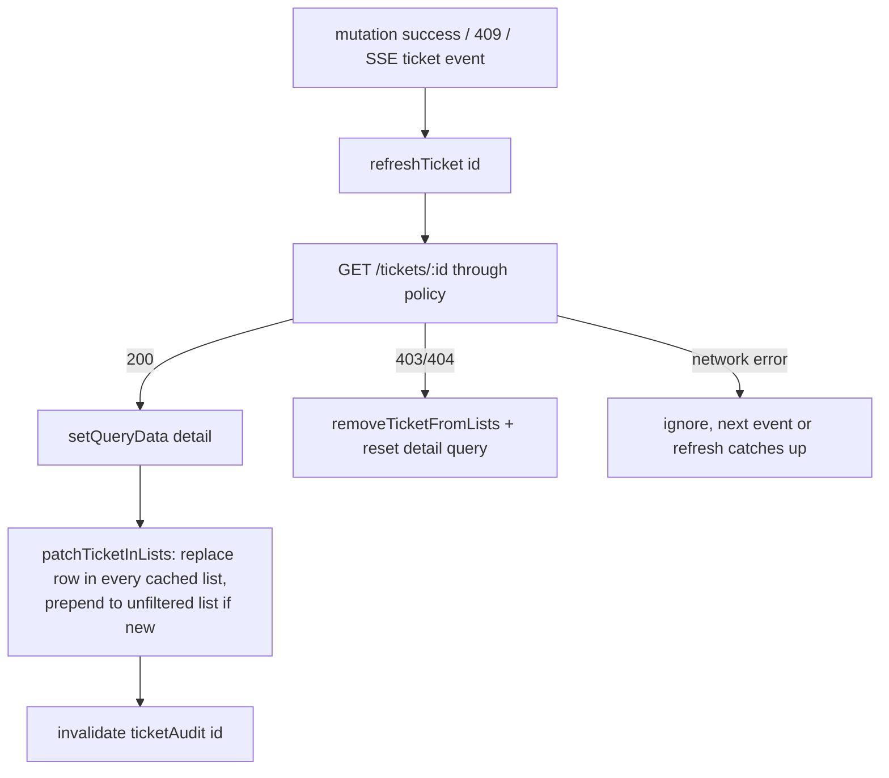

# Frontend: the ticket queue

The case worker's main screen at `/tickets`: paged list, debounced server search, quick views, filters in the URL, and cache patching after changes.

[Back to Tickets index](README.md) · General React Query patterns: [frontend-architecture/data-fetching.md](../frontend-architecture/data-fetching.md)

---

## 1. Files

| File | Job |
|---|---|
| [tickets-page.tsx](../../apps/web/src/features/tickets/tickets-page.tsx) | Toolbar (search, filters, views), table, "Load more", create button |
| [ticket-table.tsx](../../apps/web/src/features/tickets/ticket-table.tsx) | TanStack Table columns, client-side sorting, accessible links |
| [use-ticket-queries.ts](../../apps/web/src/features/tickets/use-ticket-queries.ts) | `useTicketList`, `useTicket`, `useCategories`, `useTicketMutation` |
| [ticket-cache.ts](../../apps/web/src/features/tickets/ticket-cache.ts) | `refreshTicket`, `patchTicketInLists`, `removeTicketFromLists` |
| [create-ticket-modal.tsx](../../apps/web/src/features/tickets/create-ticket-modal.tsx) | New-ticket form |

---

## 2. `useTicketList(search)`: one hook, two modes

[use-ticket-queries.ts#L17-L26](../../apps/web/src/features/tickets/use-ticket-queries.ts#L17-L26):

```ts
return useInfiniteQuery({
  queryKey: queryKeys.ticketList(search),                       // ['tickets','list',search]
  queryFn: async ({ pageParam }) => (search
    ? { items: await searchTickets(user, search), next: null }  // search: one page
    : listTicketsPage(user, pageParam)),                        // list: cursor pages
  initialPageParam: undefined as string | undefined,
  getNextPageParam: (last) => last.next ?? undefined,           // from X-Next-Cursor
  placeholderData: keepPreviousData                             // no blank flash while typing
});
```

| Term | Plain meaning |
|---|---|
| `useInfiniteQuery` | A query made of pages; `fetchNextPage()` appends the next one |
| `pageParam` | The cursor for the next page (undefined = first page) |
| `keepPreviousData` | Keep showing the old rows until new ones arrive |
| Query key includes `search` | Each search term has its own cache entry |

`listTicketsPage` reads the cursor from the `X-Next-Cursor` header ([api.ts#L115-L120](../../apps/web/src/api.ts#L115-L120)).

---

## 3. URL as state

[tickets-page.tsx#L44-L58](../../apps/web/src/features/tickets/tickets-page.tsx#L44-L58):

```ts
const view = params.get('view') ?? 'open';
const setParam = (key, value) => setParams((current) => { const next = new URLSearchParams(current); value ? next.set(key, value) : next.delete(key); return next; }, { replace: true });
const [searchInput, setSearchInput] = useState(params.get('q') ?? '');
const [search] = useDebouncedValue(searchInput.trim(), 350);   // ask the server once typing pauses
useEffect(() => setParam('q', search), [search]);
```

| Choice | Why |
|---|---|
| View, status, priority, queue and `q` live in the **URL** | Back from a ticket returns to the same list; filtered lists can be bookmarked or shared |
| `replace: true` | Typing doesn't create 20 history entries |
| 350 ms **debounce** | One server search per pause, not one per keystroke (and each search is audited) |
| Functional `setParams` update | Never reads stale params |

---

## 4. Quick views are client-side filters

[tickets-page.tsx#L29-L36](../../apps/web/src/features/tickets/tickets-page.tsx#L29-L36):

| View | Test over loaded rows |
|---|---|
| Open | status not resolved/closed/cancelled |
| Assigned to me | `assigned_to === profile.subject` |
| Unassigned | no assignee |
| Overdue | `slaStatus` breached / first_response_overdue |
| Complaints | `is_complaint` |
| All | everything loaded |

**Important honesty:** counts on the view buttons are counts of **loaded** rows, not queue totals. For exact totals you'd need server-side filters. Search results don't carry SLA or assignee fields, so views are disabled while searching ([L65-L70](../../apps/web/src/features/tickets/tickets-page.tsx#L65-L70)) and the "Next due" column shows a dash instead of a misleading "On track" ([ticket-table.tsx#L45](../../apps/web/src/features/tickets/ticket-table.tsx#L45)).

---

## 5. The table

[ticket-table.tsx](../../apps/web/src/features/tickets/ticket-table.tsx) uses **TanStack Table**, which is "headless": it handles columns and sorting, and we render with Mantine.

- The subject is a real `<Link>`, so keyboard and screen-reader users can open it and middle-click opens a tab ([L28](../../apps/web/src/features/tickets/ticket-table.tsx#L28)).
- Clicking anywhere on the row also navigates (mouse convenience).
- `aria-sort` on headers ([L81](../../apps/web/src/features/tickets/ticket-table.tsx#L81)).
- `nextDue` shows the deadline that matters next ([L19](../../apps/web/src/features/tickets/ticket-table.tsx#L19)).
- `PersonName` resolves the assignee ID to a name ([L56](../../apps/web/src/features/tickets/ticket-table.tsx#L56)).

---

## 6. Cache patching (`ticket-cache.ts`)

Instead of re-downloading every list after one ticket changes:



[ticket-cache.ts#L57-L69](../../apps/web/src/features/tickets/ticket-cache.ts#L57-L69). Two details:

- `toRow` strips nested collections (notes, attachments...) before storing a list row ([L19-L22](../../apps/web/src/features/tickets/ticket-cache.ts#L19-L22)).
- **403/404 removes the row.** If a ticket moved to a queue you can't see, or became restricted, it disappears instead of lingering stale.

---

## 7. `useTicketMutation`: the shared mutation hook

[use-ticket-queries.ts#L47-L64](../../apps/web/src/features/tickets/use-ticket-queries.ts#L47-L64):

```ts
return useMutation({
  mutationFn: (variables) => action(user, variables),
  onSuccess: async (result) => { await refreshTicket(queryClient, user, ticketId); if (successMessage) notifySuccess(...); },
  onError: (error) => { if (error instanceof ApiError && error.status === 409) void refreshTicket(queryClient, user, ticketId); }
});
```

Every ticket action (note, status, assign, upload, communicate, link, compliance, retention) uses it, so behaviour is identical everywhere. Mutations are **never retried automatically** ([query-client.ts#L24](../../apps/web/src/lib/query-client.ts#L24)), because a retried POST could act twice.

---

## 8. Create modal

[create-ticket-modal.tsx#L44-L65](../../apps/web/src/features/tickets/create-ticket-modal.tsx#L44-L65): scope from `/me`, references sent as an array, then on success:

```ts
queryClient.setQueryData(queryKeys.ticket(ticket.id), ticket);   // open instantly, no refetch
patchTicketInLists(queryClient, ticket, { addIfMissing: true }); // appears at the top of the queue
navigate(`/tickets/${ticket.id}`);
```

The alert in the form ([L91-L93](../../apps/web/src/features/tickets/create-ticket-modal.tsx#L91-L93)) tells staff to use opaque IDs, never raw account or card numbers.

## 9. Interview answer

> The queue uses one infinite query keyed by the search term: cursor pages for the list, one page for a debounced server search. Filters live in the URL so Back and bookmarks work. After any change, or an SSE hint, I refetch that one ticket through the authorised API and patch it into the detail cache and every list containing it. If the API now says 403 or 404, I remove it. Quick-view counts are explicitly over loaded rows, and mutations never auto-retry.

Next: [Frontend: the case workspace](frontend-workspace.md)
