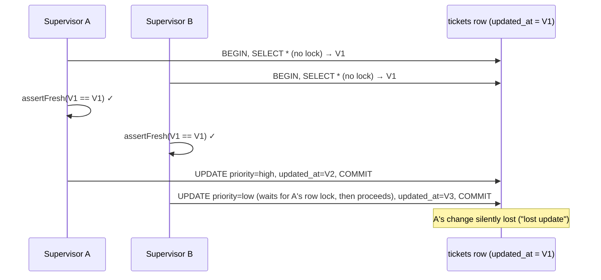

# Ticket mutations and concurrency

Edits, notes, links, sensitive reveal and retention controls, plus the most important honest caveat in the codebase: the optimistic-concurrency check is not atomic.

[Back to Tickets index](README.md) · Terms: [concepts](concepts.md)

---

## 1. The shared mutation skeleton

Almost every ticket mutation follows this shape:

```ts
return this.db.transaction(async (client) => {
  const ticket = await this.ticket(client, ticketId);             // SELECT * FROM tickets WHERE id=$1  (no lock)
  this.policy.assertTicketAccess(user, ticket, '<permission>');   // RBAC + ABAC on the current row
  this.assertFresh(ticket, dto.expectedUpdatedAt);                // optional optimistic check
  /* domain rules: redacted? communications blocked? workflow? */
  const updated = await client.query('UPDATE ... RETURNING *', [...]);
  await this.audit.write(client, {...});                          // same client → atomic
  await this.outbox.enqueue(client, {...});
  await this.live.notify(client, '<event>', updated.rows[0]);     // delivered after COMMIT
  return this.publicTicket(updated.rows[0]);
});
```

| Mutation | Route | Service lines | Permission | Domain rules |
|---|---|---|---|---|
| Edit priority/description/custom fields | `PATCH /:id` | [L120-L129](../../apps/api/src/tickets/tickets.service.ts#L120-L129) | `ticket:update` | optimistic version |
| Add note | `POST /:id/notes` | [L154-L166](../../apps/api/src/tickets/tickets.service.ts#L154-L166) | `ticket:update` | not redacted; customer note blocked if comms blocked |
| Change status | `POST /:id/status` | [L168-L196](../../apps/api/src/tickets/tickets.service.ts#L168-L196) | `ticket:update` | workflow, root cause, IDR outcome ([status-change-flow](status-change-flow.md)) |
| Assign | `POST /:id/assignments` | [L131-L142](../../apps/api/src/tickets/tickets.service.ts#L131-L142) | `ticket:assign` | target queue in the user's queues ([manual assignment](../assignment-and-routing/manual-assignment.md)) |
| Link tickets | `POST /:id/relationships` | [L257-L268](../../apps/api/src/tickets/tickets.service.ts#L257-L268) | update on source, read on target | same entity+country; duplicate → 409 |
| Reveal references | `POST /:id/sensitive-reveals` | [L144-L152](../../apps/api/src/tickets/tickets.service.ts#L144-L152) | `ticket:reveal` | **step-up** |
| Retention / legal hold | `PUT /:id/retention` | [L103-L118](../../apps/api/src/tickets/tickets.service.ts#L103-L118) | `ticket:hold` | **step-up**, reason required for a hold, date must be in the future |

---

## 2. Each mutation, in detail

### Edit (`PATCH`)

```sql
UPDATE tickets SET priority=COALESCE($1,priority), description=COALESCE($2,description),
  custom_fields=COALESCE($3,custom_fields), updated_at=now() WHERE id=$4 RETURNING *
```

`COALESCE($n, column)` gives "only change what was sent" in one statement. The audit metadata comes from `changeSummary` ([L372-L379](../../apps/api/src/tickets/tickets.service.ts#L372-L379)):

```json
{ "previousPriority": "normal", "newPriority": "critical",
  "descriptionChanged": true, "descriptionOldLength": 13, "descriptionNewLength": 14,
  "descriptionOldSha256": "…", "descriptionNewSha256": "…", "customFieldsChanged": "productCode" }
```

**Plain:** the audit trail can *prove* the description changed, and from what to what, using fingerprints, without storing the text. Only fingerprints, never content, go into the immutable trail.

### Notes

- Internal or customer visibility ([AddNoteDto, ticket.dto.ts#L41](../../apps/api/src/tickets/ticket.dto.ts#L41)).
- A **customer** note sets `first_responded_at` if unset ([L160](../../apps/api/src/tickets/tickets.service.ts#L160)); it counts as the first response for the SLA.
- Refused when `communications_blocked` (tipping-off control) or the ticket is redacted ([L157-L158](../../apps/api/src/tickets/tickets.service.ts#L157-L158)).
- Audit and outbox record `visibility` only, never the body.

### Links

- Needs **update** on the source and **read** on the target, and both in the same entity+country ([L259-L261](../../apps/api/src/tickets/tickets.service.ts#L259-L261)).
- The composite primary key prevents duplicates. The service maps the named constraint `ticket_relationship_pk` to 409 ([L262-L263](../../apps/api/src/tickets/tickets.service.ts#L262-L263)), and a `CHECK source <> target` blocks self-links at the database level.

### Reveal

- `ticket:reveal` (supervisors) + `assertStepUp('reveal customer references')`.
- Returns `opaqueReference` values **only in this response**. The UI shows them once in a modal and does not cache them ([case-sidebar.tsx#L37-L38](../../apps/web/src/features/ticket/case-sidebar.tsx#L37-L38)).
- Audit records `count`, not values.

### Retention control

- `ticket:hold` + step-up.
- `INSERT ... ON CONFLICT (ticket_id) DO UPDATE` (an upsert) ([L109-L112](../../apps/api/src/tickets/tickets.service.ts#L109-L112)).
- Audit stores the new and previous hold/date and `hasHoldReason`. The **reason text stays out** of audit and outbox. See [Retention](../retention/README.md).

---

## 3. The concurrency gap (be honest about this)

`assertFresh` ([L369-L371](../../apps/api/src/tickets/tickets.service.ts#L369-L371)):

```ts
if (expectedUpdatedAt && new Date(expectedUpdatedAt).getTime() !== ticket.updated_at.getTime())
  throw new ConflictException({ statusCode: 409, error: 'Conflict', code: 'stale_ticket', message: '...Refresh and try again.' });
```

What it **does** catch: a browser that loaded version V1, while someone else already committed V2. The test at [workflow.integration-spec.ts#L292](../../apps/api/test/workflow.integration-spec.ts#L292) proves this ("rejects stale edits").

What it **does not** catch: two requests arriving at the same time.



Why: the read has no `FOR UPDATE`, and the `UPDATE` has no `WHERE updated_at = $expected`. PostgreSQL's default READ COMMITTED isolation lets B's UPDATE proceed once A commits.

### The fix (two options)

**Option A: compare-and-set in SQL (preferred for optimistic locking)**

```sql
UPDATE tickets SET priority = $1, updated_at = now()
WHERE id = $2 AND updated_at = $3          -- the version the client saw
RETURNING *;
-- 0 rows → 409 stale_ticket
```

**Option B: pessimistic row lock**

```ts
const ticket = (await client.query('SELECT * FROM tickets WHERE id=$1 FOR UPDATE', [ticketId])).rows[0];
```

An integer `version` column is often cleaner than timestamp equality. **Prove it** with a two-connection barrier test (both read, then both update; exactly one must win). That test should fail today and pass after the fix.

### Where locks ARE used today

| Place | Lock | Code |
|---|---|---|
| Idempotency record | `FOR UPDATE` on the record | [L38](../../apps/api/src/tickets/tickets.service.ts#L38) |
| Attachment complete/scan | `FOR UPDATE` on the attachment | [L217](../../apps/api/src/tickets/tickets.service.ts#L217), [L230](../../apps/api/src/tickets/tickets.service.ts#L230) |
| Approval decision | `FOR UPDATE` on approval + communication | [L330](../../apps/api/src/tickets/tickets.service.ts#L330), [L339](../../apps/api/src/tickets/tickets.service.ts#L339) |
| Customer reply | `FOR UPDATE` on the ticket | [customer-reply.service.ts#L23](../../apps/api/src/intake/customer-reply.service.ts#L23) |
| Escalation | `FOR UPDATE` on the ticket | [escalation.service.ts#L48](../../apps/api/src/workflow/escalation.service.ts#L48) |
| Retention | `FOR UPDATE OF t` | [retention.service.ts#L41](../../apps/api/src/retention/retention.service.ts#L41) |
| Auto-assign | advisory lock per queue | [assignment.service.ts#L22](../../apps/api/src/tickets/assignment.service.ts#L22) |
| Audit chain | advisory lock 804231 | [audit.service.ts#L16](../../apps/api/src/audit/audit.service.ts#L16) |

---

## 4. How the frontend uses `expectedUpdatedAt`

Every edit sends `ticket.updatedAt` from the cached ticket:

- priority: [case-sidebar.tsx#L36](../../apps/web/src/features/ticket/case-sidebar.tsx#L36)
- description: [description-card.tsx#L16](../../apps/web/src/features/ticket/description-card.tsx#L16)
- status: [change-status-modal.tsx#L38](../../apps/web/src/features/ticket/change-status-modal.tsx#L38)
- assign: [assign-modal.tsx#L40](../../apps/web/src/features/ticket/assign-modal.tsx#L40)

On 409, `useTicketMutation` re-reads the ticket ([use-ticket-queries.ts#L60-L62](../../apps/web/src/features/tickets/use-ticket-queries.ts#L60-L62)), so the user immediately sees the newer version they were about to overwrite. The global mutation error handler shows the message toast.

---

## 5. Other gaps to mention

| Gap | Fix |
|---|---|
| `:ticketId` not parsed as UUID on most routes | `@Param('ticketId', ParseUUIDPipe)` everywhere → clean 400 |
| Manual assignee not validated | Check `queue_members` / directory inside the transaction |
| Policy evaluated on an unlocked snapshot | Same fix as section 3 |

Next: [Status change, end to end](status-change-flow.md)
