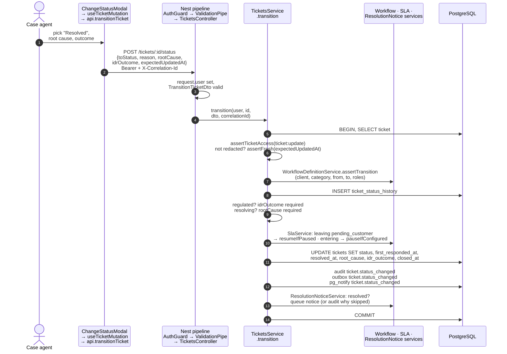
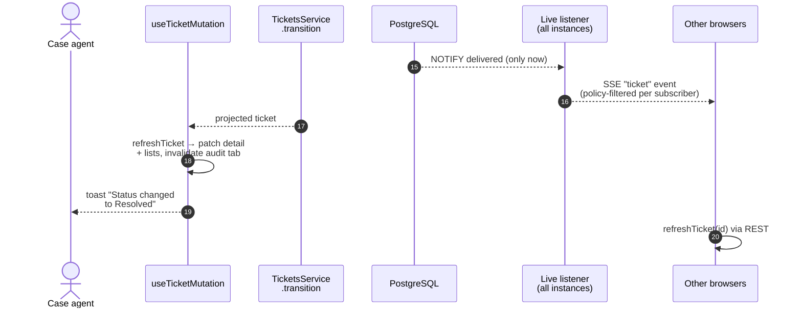

# Status change, end to end

The single best "walk me through it" story in the codebase. It touches auth, validation, policy, workflow, SLA, audit, outbox, live events, communications and React Query.

[Back to Tickets index](README.md)

---

## 1. The full journey

**Part A: from click to `COMMIT`**



**Part B: after `COMMIT`** (live fan-out and UI refresh). Numbering continues from part A.



---

## 2. Frontend: building the command

[change-status-modal.tsx#L18-L68](../../apps/web/src/features/ticket/change-status-modal.tsx#L18-L68)

| Rule in the form | Code | Server enforces it too? |
|---|---|---|
| Only `allowedNextStatuses` are offered | [L48-L49](../../apps/web/src/features/ticket/change-status-modal.tsx#L48-L49) | Yes: `assertTransition` |
| Resolving needs a root cause | [L50-L54](../../apps/web/src/features/ticket/change-status-modal.tsx#L50-L54) | Yes ([service L179](../../apps/api/src/tickets/tickets.service.ts#L179)) |
| Complaint/privacy needs an outcome | [L55-L58](../../apps/web/src/features/ticket/change-status-modal.tsx#L55-L58) | Yes ([L175-L178](../../apps/api/src/tickets/tickets.service.ts#L175-L178)) |
| Save disabled until complete | `incomplete` [L29](../../apps/web/src/features/ticket/change-status-modal.tsx#L29) | n/a |
| Reason defaults to "Status changed to X by Y" | [L37](../../apps/web/src/features/ticket/change-status-modal.tsx#L37) | DTO requires 2-500 chars |
| `expectedUpdatedAt = ticket.updatedAt` | [L38](../../apps/web/src/features/ticket/change-status-modal.tsx#L38) | Yes: `assertFresh` |

The API call is `transitionTicket` ([api.ts#L134-L135](../../apps/web/src/api.ts#L134-L135)).

---

## 3. Nest boundaries, in order

1. Fastify parses (1 MiB limit), rate limits, applies CORS.
2. `AuthGuard` → `request.user`, `request.correlationId`.
3. Global interceptors enter (metrics, denied-audit).
4. `ValidationPipe` → `TransitionTicketDto` ([ticket.dto.ts#L44](../../apps/api/src/tickets/ticket.dto.ts#L44)): `toStatus ∈ TICKET_STATUSES`, `reason` 2-500, optional `expectedUpdatedAt` (ISO), `rootCause ∈ ROOT_CAUSES`, `idrOutcome ∈ the 8 outcomes`.
5. `TicketsController.transition` ([L139-L150](../../apps/api/src/tickets/tickets.controller.ts#L139-L150)) forwards the call.

A missing token → 401 before the DTO is checked. A bad DTO → 400 before the service runs.

---

## 4. The service transaction

[tickets.service.ts#L168-L196](../../apps/api/src/tickets/tickets.service.ts#L168-L196)

| Lines | What | Why |
|---|---|---|
| [170](../../apps/api/src/tickets/tickets.service.ts#L170) | load + `assertTicketAccess(ticket:update)` | Row-level policy |
| [171](../../apps/api/src/tickets/tickets.service.ts#L171) | refuse if `redacted_at` | De-identified tickets are frozen |
| [172](../../apps/api/src/tickets/tickets.service.ts#L172) | `assertFresh` | Stale-edit protection (see the [caveat](mutations-and-concurrency.md#3-the-concurrency-gap-be-honest-about-this)) |
| [173](../../apps/api/src/tickets/tickets.service.ts#L173) | `assertTransition(client, ...)` | Edge must exist in the category's active workflow; role limits apply (only supervisors cancel). No edge → 409, wrong role → 403 |
| [174](../../apps/api/src/tickets/tickets.service.ts#L174) | INSERT status history | Timeline + reporting |
| [175-L179](../../apps/api/src/tickets/tickets.service.ts#L175-L179) | outcome / root cause checks | 400 if missing; history insert rolls back too |
| [181](../../apps/api/src/tickets/tickets.service.ts#L181) | `resumeIfPaused` when leaving `pending_customer` | Shift deadlines by the paused time |
| [182](../../apps/api/src/tickets/tickets.service.ts#L182) | `pauseIfConfigured` when entering it | Stop the clock if the policy says so |
| [183-L189](../../apps/api/src/tickets/tickets.service.ts#L183-L189) | one `UPDATE` with `CASE` expressions | Sets/clears `first_responded_at`, `resolved_at`, `root_cause`, `idr_outcome`, `closed_at` depending on target status |
| [190-L191](../../apps/api/src/tickets/tickets.service.ts#L190-L191) | audit + outbox | Facts only: from, to, root cause, outcome |
| [192](../../apps/api/src/tickets/tickets.service.ts#L192) | `live.notify` | `pg_notify` inside the txn |
| [193](../../apps/api/src/tickets/tickets.service.ts#L193) | resolution notice | Customer told in the same commit, or a recorded reason why not ([Communications](../communications/resolution-notice.md)) |

### The `CASE` update explained

```sql
first_responded_at = CASE WHEN $1 IN ('pending_customer','resolved') THEN COALESCE(first_responded_at, now()) ELSE first_responded_at END,
resolved_at       = CASE WHEN $1='resolved' THEN now() WHEN $1='reopened' THEN NULL ELSE resolved_at END,
root_cause        = CASE WHEN $1='resolved' THEN $3   WHEN $1='reopened' THEN NULL ELSE root_cause END,
idr_outcome       = CASE WHEN $1='resolved' THEN $4   WHEN $1='reopened' THEN NULL ELSE idr_outcome END,
closed_at         = CASE WHEN $1 IN ('closed','cancelled') THEN now() WHEN $1='reopened' THEN NULL ELSE closed_at END
```

**Plain:** resolving stamps when and why; reopening wipes those stamps; asking the customer for information (or resolving) counts as the first response; closing starts the retention clock.

`$1::text` casts appear because the same parameter is compared in several places, and PostgreSQL needs one consistent type.

---

## 5. After commit

| Effect | Guarantee | Where to read more |
|---|---|---|
| HTTP response | Projected ticket | n/a |
| Outbox row | Will be published **at least once** | [Outbox](../outbox/README.md) |
| SSE hint | Only if the commit happened (`NOTIFY` is transactional); policy-filtered; may be lost if the listener was down → `resync` | [Live updates](../live-updates/README.md) |
| Resolution notice | Queued or pending approval in the same commit; delivered later by a worker | [Communications](../communications/README.md) |
| Notifications | Supervisors told when an approval is waiting | [Notifications](../notifications/README.md) |

**The database is the authority.** An outbox row or an SSE hint doesn't mean anyone downstream has acted yet.

---

## 6. React Query convergence

[use-ticket-queries.ts#L47-L64](../../apps/web/src/features/tickets/use-ticket-queries.ts#L47-L64):

- **success** → `await refreshTicket(...)` (GET the ticket, write the detail cache, patch every list containing it, invalidate its audit query), then the toast.
- **409** → `refreshTicket` too, so the user sees the winner's version.
- Other errors → global toast ([query-client.ts#L28-L30](../../apps/web/src/lib/query-client.ts#L28-L30)).

Other browsers receive an SSE `ticket` event and call the same `refreshTicket` ([use-live-updates.ts#L24](../../apps/web/src/live/use-live-updates.ts#L24)). They **refetch**; they never merge the event payload into the cache.

---

## 7. Failure map

| Condition | Status / layer | Durable effect |
|---|---|---|
| Missing or invalid token | 401 guard | none |
| Bad target / reason / timestamp format | 400 pipe | none |
| Out of scope / no update permission | 403 policy | rollback; `authorization.denied` audited separately |
| Ticket not found | 404 | none |
| Redacted ticket | 409 | none |
| Stale `expectedUpdatedAt` | 409 `stale_ticket` | none; UI refetches |
| Illegal edge | 409 | none |
| Role not allowed for this edge | 403 | none |
| Missing root cause / outcome | 400 | history insert rolled back |
| Audit or outbox insert fails | 500 | **everything** rolled back |
| SSE listener down after commit | none | state committed; clients `resync` later |

---

## 8. Interview answer (2 minutes)

> The modal offers only the next statuses the server returned and sends the target, reason, root cause and outcome where needed, plus the `updatedAt` it last saw. `AuthGuard` sets the user, the `ValidationPipe` checks `TransitionTicketDto`, and `TicketsService.transition` loads the ticket, applies ticket policy, rejects redacted or stale state, and asks the workflow service whether that edge exists for the category and the user's roles. In one transaction it writes status history, pauses or resumes the SLA, updates the outcome fields with a single `CASE` update, appends audit, enqueues an outbox event and issues `pg_notify`. If resolving, it also queues the customer's resolution notice. After commit the client refetches and patches its caches; other browsers get a policy-filtered SSE hint and refetch. One caveat: the stale check isn't atomic because the read isn't locked, so I'd make it a conditional update and prove it with a two-connection test.

Next: [Frontend: the queue](frontend-queue.md)
