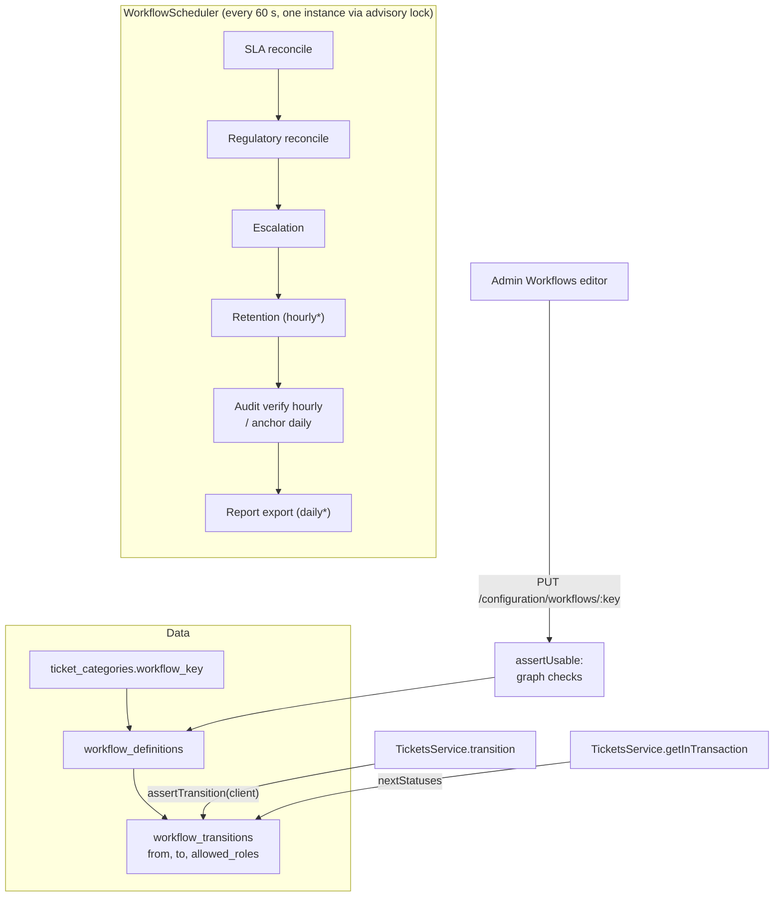

# Workflow: lifecycle rules and the scheduler

> **Workflow (state machine)**: the set of legal moves between ticket statuses, for example `triage → assigned` is allowed but `submitted → resolved` is not. Moves can be limited to certain roles.
> **Workflow as data**: the moves live in database tables, not in `if` statements, so a bank changes its process without a code release.
> **Scheduler**: the background timer that, once a minute, recalculates SLA and regulatory status, runs escalations, and periodically runs retention, audit verification/anchoring and report export.

## Picture

\* opt-in by environment flag.

## Where it lives

| File | Role |
|---|---|
| [workflow/workflow-definition.service.ts](../../apps/api/src/workflow/workflow-definition.service.ts) | `assertTransition`, `nextStatuses`, `list`, `upsert`, `assertUsable` |
| [workflow/workflow-definition.controller.ts](../../apps/api/src/workflow/workflow-definition.controller.ts) | `GET/PUT /v1/configuration/workflows` |
| [workflow/workflow-scheduler.ts](../../apps/api/src/workflow/workflow-scheduler.ts) | The timer tick |
| [workflow/escalation.service.ts](../../apps/api/src/workflow/escalation.service.ts) | Escalation rules (explained in [assignment-and-routing/escalation.md](../assignment-and-routing/escalation.md)) |
| [workflow/workflow.module.ts](../../apps/api/src/workflow/workflow.module.ts) | `@Global`; also registers `RetentionService` |
| [migrations/1710000019000_workflow_definitions.cjs](../../apps/api/migrations/1710000019000_workflow_definitions.cjs) | Tables + the seeded `standard` workflow |
| [admin/sections/workflows-section.tsx](../../apps/web/src/features/admin/sections/workflows-section.tsx) | JSON editor with live validation |

## Read in this order

1. [Workflow definitions (state machine)](definitions.md): the standard lifecycle, transition checks, graph validation, the editor.
2. [The scheduler](scheduler.md): what runs every tick, multi-instance safety, lifecycle hooks.
3. [Interview Q&A](interview-qa.md)

## Glossary

| Term | Plain meaning |
|---|---|
| **State / status** | Where the ticket is in its life (`in_progress`, `resolved`, ...) |
| **Transition / edge** | A permitted move from one status to another |
| **Directed graph** | Statuses are dots; transitions are one-way arrows |
| **Terminal status** | An end: `closed` or `cancelled` |
| **Reachability** | "From here, can I eventually get to an end?" Checked with depth-first search |
| **Role-limited edge** | A move only certain roles may make (only supervisors may cancel) |
| **Advisory lock (try)** | `pg_try_advisory_xact_lock`: "take the talking stick if free, otherwise skip". Used so only one API instance runs each tick |
| **Lifecycle hook** | `onModuleInit` / `onModuleDestroy`: Nest calls them on start and shutdown to start or stop timers |

## 30-second answer

> Ticket lifecycles are directed graphs stored in `workflow_definitions` and `workflow_transitions`, linked from each category. Every status change calls `assertTransition` inside the same transaction: no edge is a 409, and an edge limited to roles the user doesn't hold is a 403. The UI gets `allowedNextStatuses` filtered by role, but that's only a convenience. Saving a workflow validates the graph: no self-loops, `submitted` must have an exit, and every status must be able to reach `closed` or `cancelled`. A scheduler with a PostgreSQL try-advisory lock runs SLA, regulatory and escalation work once per minute on exactly one instance.

## Related

[Tickets status flow](../tickets/status-change-flow.md) · [SLA](../sla/README.md) · [Escalation](../assignment-and-routing/escalation.md) · [Compliance clocks](../compliance/regulatory-clocks.md) · [Retention](../retention/README.md) · [Audit integrity](../audit/integrity-and-anchors.md) · [Learn NestJS → lifecycle hooks and workers](../learn-nestjs/07-lifecycle-hooks-and-workers/README.md)
