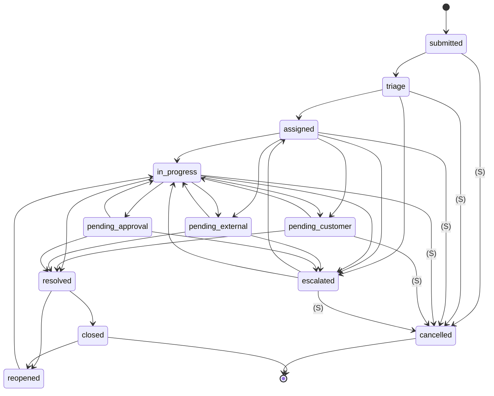

# Workflow definitions (the state machine)

[Back to Workflow index](README.md) · Code: [workflow-definition.service.ts](../../apps/api/src/workflow/workflow-definition.service.ts)

---

## 1. The seeded `standard` workflow

Seeded by [migration 1710000019000](../../apps/api/migrations/1710000019000_workflow_definitions.cjs). Edges marked **(S)** are supervisor-only.



Automatic moves that bypass the editor's edges but are written to history: auto-assignment sets `assigned` ([assignment.service.ts#L33](../../apps/api/src/tickets/assignment.service.ts#L33)), escalation sets `escalated` ([escalation.service.ts#L53](../../apps/api/src/workflow/escalation.service.ts#L53)), and manual assignment sets `assigned`. The customer-reply path **does** check the workflow before moving `pending_customer → in_progress` ([customer-reply.service.ts#L30](../../apps/api/src/intake/customer-reply.service.ts#L30)).

---

## 2. Tables

| Table | Key | Columns |
|---|---|---|
| `workflow_definitions` | `workflow_key` | `label`, `active`, `updated_by/at` |
| `workflow_transitions` | PK `(workflow_key, from_status, to_status)` | `allowed_roles text[]` (NULL = any role with `ticket:update`) |
| `ticket_categories` | n/a | `workflow_key` (default `standard`) |

---

## 3. Checking a transition

[assertTransition, L37-L43](../../apps/api/src/workflow/workflow-definition.service.ts#L37-L43):

```ts
const row = (await client.query(`
  SELECT wt.allowed_roles FROM workflow_transitions wt
  JOIN ticket_categories c ON c.workflow_key = wt.workflow_key
  JOIN workflow_definitions wd ON wd.workflow_key = wt.workflow_key
  WHERE c.category_key=$1 AND wd.active=true AND wt.from_status=$2 AND wt.to_status=$3`, [category, from, to])).rows[0];
if (!row) throw new ConflictException(`Transition from ${from} to ${to} is not allowed`);
if (row.allowed_roles && !row.allowed_roles.some((role) => roles.includes(role))) throw new ForbiddenException(`Only ${row.allowed_roles.join(' or ')} can move a ticket from ${from} to ${to}`);
```

| Detail | Plain reason |
|---|---|
| Takes the caller's `client` | Checked in the **same transaction** as the update, so there is no time-of-check/time-of-use gap |
| One SQL join (category → workflow → edge) | Category decides which workflow applies; an inactive workflow allows nothing |
| No row → **409 Conflict** | "That move doesn't exist", a state problem |
| Role mismatch → **403 Forbidden** | "That move exists, but not for you", a permission problem |

The general `ticket:update` permission is checked first by `assertTicketAccess`. Role limits are an *extra* filter on specific edges.

## 4. Next statuses for the UI

[nextStatuses, L45-L52](../../apps/api/src/workflow/workflow-definition.service.ts#L45-L52) returns the reachable targets filtered by the user's roles, embedded in the ticket detail as `allowedNextStatuses` ([tickets.service.ts#L361](../../apps/api/src/tickets/tickets.service.ts#L361)). The status modal offers only those. **The mutation re-checks anyway.** If the workflow changed after the page loaded, the server answers 409.

The comment at [L46](../../apps/api/src/workflow/workflow-definition.service.ts#L46) explains the optional `client` parameter: inside a transaction, asking the pool for a second connection while holding one can **deadlock a busy pool** (every connection is held by a request waiting for another connection).

---

## 5. Saving a workflow: graph validation

[upsert L62-L76](../../apps/api/src/workflow/workflow-definition.service.ts#L62-L76) + [assertUsable L78-L88](../../apps/api/src/workflow/workflow-definition.service.ts#L78-L88):

```ts
const edges = new Map<string, Set<string>>();
for (const t of transitions) { if (t.from === t.to) throw ...('A status cannot transition to itself'); edges[t.from].add(t.to); }
if (!edges.get('submitted')?.size) throw ...('A ticket must be able to leave the submitted status');
const terminal = new Set(['closed', 'cancelled']);
const reachesTerminal = (start) => { /* iterative DFS with a visited set */ };
for (const status of allStatusesMentioned) if (!terminal.has(status) && !reachesTerminal(status)) throw ...(`Status ${status} cannot reach closed or cancelled`);
if (!mentioned.has('closed') && !mentioned.has('cancelled')) throw ...('A workflow needs a closed or cancelled status');
```

| Rule | Why it matters |
|---|---|
| No self-loop | `in_progress → in_progress` is meaningless and would pollute history |
| `submitted` has an exit | Otherwise new tickets are stuck forever |
| Every mentioned status can reach a terminal | No dead ends: a ticket can always be finished |
| At least one terminal exists | Same |

**Algorithm:** depth-first search (DFS) with an explicit stack and a `seen` set to avoid infinite loops on cycles (`resolved ↔ reopened`). Plain words: from every status, follow arrows until you hit `closed` or `cancelled`, or run out of new places to visit.

The save itself, in one transaction:
1. Read a bounded "before" summary of the definition and edges, for audit.
2. Upsert the definition; **delete and re-insert all edges** (full replace, simpler than diffing).
3. Audit `configuration.workflow_updated` with the previous transitions; outbox `configuration.workflow_changed`.

The DTO ([L14-L25](../../apps/api/src/workflow/workflow-definition.service.ts#L14-L25)) limits `from`/`to` to known statuses, `allowedRoles` to staff roles, and caps the size (200 edges, 10 roles). The key must match `^[a-z0-9][a-z0-9-]{1,59}$`.

---

## 6. The editor

[workflows-section.tsx#L27-L81](../../apps/web/src/features/admin/sections/workflows-section.tsx#L27-L81):

- Each workflow is shown as readable rows "Status → [badges]", with `*` on role-limited edges.
- Editing uses **JSON in a textarea**, parsed on every keystroke and showing the parse error inline ([L33-L40](../../apps/web/src/features/admin/sections/workflows-section.tsx#L33-L40)). The comment explains why: a workflow is a small graph that doesn't fit a simple form.
- The server's reachability error (409) is shown as a toast. Nothing is saved partially.

## 7. Tests

[workflow.integration-spec.ts#L139](../../apps/api/test/workflow.integration-spec.ts#L139): "enforces data-driven workflows and rejects unusable definitions": illegal moves are refused, role-limited moves are refused for agents, and definitions with dead ends are rejected.

## 8. Why data, not code?

> Banks differ: one wants an approval step before resolve, another a "pending legal" state. Data-driven workflows let each bank configure its lifecycle while the product enforces safety invariants (no dead ends, roles, audit). A BPMN engine such as Camunda could sit alongside later by consuming the same status events, because status changes still only happen through the API ([service comment L27-L31](../../apps/api/src/workflow/workflow-definition.service.ts#L27-L31)).

Next: [The scheduler](scheduler.md)
