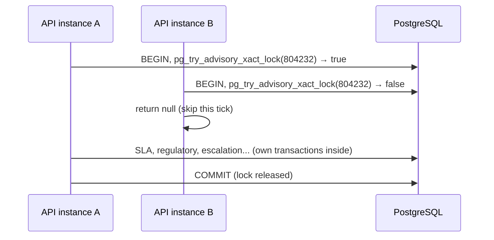

# The scheduler (background timer)

[Back to Workflow index](README.md) · Code: [workflow-scheduler.ts](../../apps/api/src/workflow/workflow-scheduler.ts)

---

## 1. What runs, and how often

| Job | Frequency | Opt-in flag | Called method |
|---|---|---|---|
| SLA status reconcile | every tick | `WORKFLOW_SCHEDULER_ENABLED=true` | [SlaService.reconcileSystem](../sla/how-it-works.md#5-reconciliation) |
| Regulatory status reconcile | every tick | same | [ComplianceService.reconcile](../compliance/regulatory-clocks.md) |
| Escalation rules | every tick | same | [EscalationService.run](../assignment-and-routing/escalation.md) |
| Retention de-identification | at most hourly | `RETENTION_ENFORCEMENT_ENABLED=true` | [RetentionService.run](../retention/README.md) |
| Audit incremental verify | hourly | on unless `AUDIT_INTEGRITY_ENABLED=false` | [AuditIntegrityService.verify](../audit/integrity-and-anchors.md) |
| Audit anchor (with full verify) | daily | same | `AuditIntegrityService.anchor` |
| Scheduled report export | daily | `REPORT_EXPORT_ENABLED=true` | [ReportExportService.runOnce](../compliance/reports-and-privacy.md#4-scheduled-report-export) |

Tick interval: `WORKFLOW_TICK_MS` (default 60,000 ms).

---

## 2. One tick

[tick(), L37-L57](../../apps/api/src/workflow/workflow-scheduler.ts#L37-L57):

```ts
return this.db.transaction(async (client) => {
  const lock = await client.query('SELECT pg_try_advisory_xact_lock($1) AS ok', [804232]);
  if (!lock.rows[0].ok) return null;                                  // another instance is ticking
  const correlationId = `timer-${randomUUID()}`;
  const sla = await this.sla.reconcileSystem(correlationId);
  const regulatory = await this.compliance.reconcile(correlationId);
  const escalation = await this.escalation.run(correlationId);
  if (RETENTION_ENFORCEMENT_ENABLED && hour passed) redacted = (await this.retention.run(correlationId)).redacted;
  if (AUDIT_INTEGRITY_ENABLED !== 'false') { daily → anchor(); else hourly → verify(); }
  if (REPORT_EXPORT_ENABLED && day passed) await this.reports.runOnce();
  return { slaUpdated, regulatoryUpdated, escalated, redacted, auditStatus };
});
```



### Why a *try* lock
- `pg_advisory_xact_lock` **waits**: instance B would queue behind A and run the same tick right after, which is wasted work.
- `pg_try_advisory_xact_lock` **returns immediately**: B skips and tries again next interval.
- `_xact_` means the lock auto-releases at commit or rollback, even if the process crashes (the connection dies, the transaction aborts).

### Correlation ID
Every audit and outbox row from one tick shares `timer-<uuid>`, so an investigator can see everything one tick did.

### Note on transactions
The lock is held by the tick's outer transaction. The SLA and regulatory reconcilers open **their own** transactions via `db.transaction` on other pool connections, and escalation opens one per ticket. The outer transaction exists to hold the lock for the tick's duration. Each job's writes commit independently, so one failing job doesn't undo another job's committed work.

---

## 3. Start, stop, re-schedule

| Hook | Code | Behaviour |
|---|---|---|
| `onModuleInit` | [L28-L32](../../apps/api/src/workflow/workflow-scheduler.ts#L28-L32) | Starts only if `WORKFLOW_SCHEDULER_ENABLED=true` and a DB is configured; first tick after 5 s |
| `schedule(delay)` | [L59-L63](../../apps/api/src/workflow/workflow-scheduler.ts#L59-L63) | `setTimeout` (not `setInterval`) + `.unref()` |
| `run()` | [L65-L71](../../apps/api/src/workflow/workflow-scheduler.ts#L65-L71) | try tick → log → catch errors → schedule the next one |
| `onModuleDestroy` | [L34](../../apps/api/src/workflow/workflow-scheduler.ts#L34) | `stopped = true`, clear the timer (graceful shutdown) |

**Why `setTimeout` chaining instead of `setInterval`?** With `setInterval`, a slow tick (60+ s) would overlap the next one. Chaining schedules the next tick only **after** the current one finishes, so there is never any overlap.

**Why `.unref()`?** A pending timer shouldn't keep Node alive during shutdown or tests.

**Why opt-in?** Tests and one-off scripts must not race a background loop. The same pattern is used by the outbox dispatcher, delivery worker, inbound email worker and scan worker.

`tick()` is public so tests can run exactly one tick deterministically ([workflow.integration-spec.ts#L342](../../apps/api/test/workflow.integration-spec.ts#L342) calls `app.get(WorkflowScheduler).tick()`).

---

## 4. "Last run" timestamps live in memory

`lastRetentionRun`, `lastAuditVerify`, `lastAuditAnchor` and `lastReportExport` are instance fields ([L26](../../apps/api/src/workflow/workflow-scheduler.ts#L26)). After a restart, or when a different instance wins the lock, the hourly/daily jobs may run again sooner than an hour or a day. That is acceptable, because each job is idempotent (anchor skips if the chain hasn't grown, retention skips already-redacted rows, reports overwrite the same day's object). Persisting "last run" in a table would make the cadence exact.

## 5. Production note

The comment ([L17](../../apps/api/src/workflow/workflow-scheduler.ts#L17)) calls this "the in-app stand-in for the Camunda timer workers planned for the pilot phase". In a larger deployment, a dedicated worker deployment (same image, scheduler enabled, API replicas with it disabled) separates load. The advisory lock already makes it safe to enable everywhere.

## 6. Interview answer

> The scheduler is a Nest provider started in `onModuleInit` behind an opt-in flag. It chains `setTimeout` calls so ticks never overlap, unrefs the timer, and stops cleanly in `onModuleDestroy`. Each tick takes `pg_try_advisory_xact_lock`, so with N replicas exactly one runs and the others skip without waiting. It runs SLA and regulatory reconciliation and escalation every minute, and retention, audit verify/anchor and report export at hourly or daily cadence. All of these are idempotent and batch-bounded, so a restart that reruns them early is harmless.
